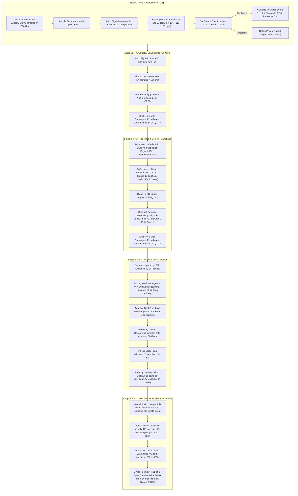

# Final Algorithm Specification (Pre-FPGA Frozen Baseline)

## 1. End-to-End Processing Architecture

The system pipeline operates across five synchronous processing stages:

---

## 2. Master Numerical Specification Table

| Stage | Parameter | Specification | Format | Hardware Resource |
| :--- | :--- | :--- | :--- | :--- |
| **System** | Sampling Rate ($f_s$) | $250\text{ Hz}$ ($T_s = 4.0\text{ ms}$) | Synchronous Strobe | System Clock Divider |
| **System** | FPGA Clock Frequency | $100.0\text{ MHz}$ ($10\text{ ns}$ cycle) | Internal Clock | Boolean Board On-board Osc |
| **I/O** | Input Channels | $4\text{ channels}$ (`[x27, x26, x28, x25]`) | Signed 16-bit (Q1.15) | ADC Interface / Serial Rx |
| **I/O** | Communication Baud | $921,600\text{ baud}$ (8-N-1) | Asynchronous Serial | FTDI USB-UART Bridge |
| **Calibration** | Duration | $4.0\text{ seconds}$ ($1,000\text{ samples}$) | Off-chip array | Host PC RAM / SVD |
| **Calibration** | Lag Search Window | $[83, 136]\text{ samples}$ ($110\text{--}180\text{ bpm}$) | Integer lag indices | Autocorrelation Engine |
| **Calibration** | Fallback Rule | Retain previous valid weights | Persistent Register | Host PC Calibration FSM |
| **Projection** | Transition Engine | $64\text{ samples}$ ($256\text{ ms}$) Linear Slew | Signed 16-bit weights | Logic Accumulator |
| **Projection** | Accumulator | $\sum_{i=0}^3 w_i x_i$ | Signed 32-bit (Q2.30) | 1x DSP48E1 Slice |
| **HP1** | High-Pass Filter | $y[n] = x[n] - \text{base}[n-1]$; $\text{base}[n] += y[n] \gg 6$ | Signed 32-bit Accumulator | Shift-Add Logic (0 DSPs) |
| **LP40** | Clean Low-Pass | 4th-order Butterworth ($40\text{ Hz}$ cutoff), 2 biquads | Signed 18-bit Q3.15, 48-bit states | 2x DSP48E1 Slices |
| **Bandpass**| Detector Bandpass | 8th-order Butterworth ($12\text{--}35\text{ Hz}$), 4 biquads | Signed 18-bit Q3.15, 48-bit states | 2x DSP48E1 Slices (multiplexed) |
| **Squarer** | Non-Linear Stage | $y[n] = (bp16)^2$ | Unsigned 32-bit (U0.30) | 1x DSP48E1 Slice |
| **MWI** | Moving Window Sum | $W = 30\text{ samples}$ ($120\text{ ms}$) | Unsigned 36-bit (U6.30) | Distributed RAM Ring Buffer |
| **Threshold**| Dual Peak Follower | $\text{thr} = \text{noise} + (\text{peak} - \text{noise}) \gg 2$ | Unsigned 36-bit registers | EMA Shift-Add Logic |
| **Refractory**| Lockout Period | $50\text{ samples}$ ($200\text{ ms} = 300\text{ bpm}$) | 6-bit down-counter | Logic Counter |
| **Search** | R-Peak Localizer | Trailing $26\text{ samples}$ ($104\text{ ms}$) | Comparator + Pointer | Circular Register File |
| **Latency** | Group Delay Comp | $-18\text{ samples}$ ($72\text{ ms}$) | Subtractor | Constant Logic |
| **Fusion** | Interval Fusion | Merge detections if $RR < 50\text{ samples}$ | Timestamp replacement | FSM Comparator |
| **Median5** | FHR Smoothing | 5-beat causal FIFO on valid $RR \in [50, 300]$ | Median of 5 elements | 5-register sorting network |
| **FHR LUT** | Instantaneous Rate | $FHR = 150,000 / RR$ for $RR \in [50, 300]$ | 251 words x 12-bit (0.1 bpm) | Block ROM ($256 \times 12$) |
