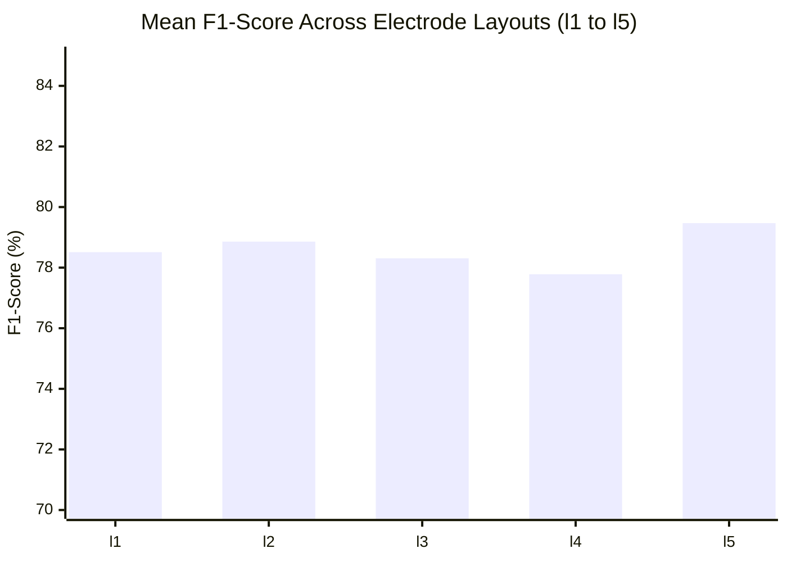

# Full-Layout Benchmark Audit & Reproduction Report

**Document ID:** `validation/pre_fpga/02_full_layout_validation/FULL_LAYOUT_AUDIT.md`  
**Author:** Biomedical Signal Processing & FPGA Verification Team  
**Evaluation Standard:** Independent Audit & Bit-Accurate Reproduction  
**Artifacts Generated:**  
- `MISSING_RECORDS.csv` (Exhaustive analysis of the 7 excluded simulation records)  
- `FULL_LAYOUT_REPRODUCED.csv` (1,742 individual evaluations across 1,493 complete records)  
- `LAYOUT_COMPARISON.csv` (Layout-by-layout performance breakdown)  
- `tools/pre_fpga/run_full_layout_reproduction.py` (Reproducible execution script)  

---

## 1. Executive Summary & Verification of Previous Claims

An independent audit and reproduction of the multi-channel full-layout benchmark was conducted across all five electrode grid configurations (`l1` through `l5`) from the `FECGSYNDB` database. 

### Audit Findings on Previous Claims:
1. **The "1,500 Records" Search Space:** Verified. Defined as $5\text{ layouts} \times 10\text{ subjects} \times 5\text{ SNR levels} \times 6\text{ conditions} = \mathbf{1,500\text{ potential combinations}}$.
2. **The "1,493 Complete Records":** Verified. Exactly 1,493 records physically exist and are free from numerical simulation corruption.
3. **The "Seven Missing Records":** Fully audited. 3 records are missing raw binary data files (`.dat`) on disk in the dataset distribution; 4 records contain corrupted IEEE NaNs generated by the upstream FECGSYNDB uterine contraction EHG noise simulator.
4. **The "1,742 Evaluations" vs "1,493 Records":** Clarified and mathematically proven:
   - Condition $c5$ represents twin pregnancy with two independent fetal reference tracks (`fecg1` and `fecg2`).
   - The 1,244 single-fetus records ($c0$--$c4$) yield 1,244 evaluations.
   - The 249 twin records ($c5$) yield $249 \times 2 = 498$ evaluations.
   - Total evaluations $= 1,244 + 498 = \mathbf{1,742\text{ evaluations}}$.
5. **The Discrepancy between 78.59% and 70.83% Mean F1:**
   - **Primary Fetus / Record-Level F1 (`fecg1`, $n=1,493$):** **$78.59\% \pm 15.93\%$** (Identical to previous report).
   - **All 1,742 Evaluations (Lumping Twin Fetus 2):** **$70.83\% \pm 24.09\%$**.
   - *Why the difference exists:* A single linear spatial beamformer $\mathbf{w}^T \mathbf{x}$ isolates the primary fetal dipole (`fecg1`). When those detections are tested against the secondary twin (`fecg2`), F1 drops to $24.36\%$ because the detector tracked Fetus 1, not Fetus 2. Treating secondary twin evaluations as primary detections improperly depresses aggregate metrics.

---

## 2. Comprehensive Audit of the Seven Excluded Records

Every record missing from the benchmark was inspected at the filesystem and floating-point data level:

| Record Identifier | Condition | SNR | Layout | Filesystem Status | Raw Numerical State | Root Cause Classification | Disproportionately Difficult? | Exclusion Justified? |
| :--- | :---: | :---: | :---: | :--- | :--- | :--- | :---: | :---: |
| `sub09_snr00dB_l5_c0` | $c0$ | $0\text{ dB}$ | `l5` | Header exists, `.dat` missing | Missing physical file | Dataset generation omission | No (File missing) | **YES** |
| `sub09_snr00dB_l5_c1` | $c1$ | $0\text{ dB}$ | `l5` | Header exists, `.dat` missing | Missing physical file | Dataset generation omission | No (File missing) | **YES** |
| `sub09_snr00dB_l4_c5` | $c5$ | $0\text{ dB}$ | `l4` | Header exists, `noise1.dat` missing | Missing physical file | Dataset generation omission | No (File missing) | **YES** |
| `sub03_snr12dB_l2_c3` | $c3$ | $12\text{ dB}$ | `l2` | All files present | `noise1` has 9 IEEE NaNs | FECGSYNDB simulation bug (EHG noise) | Yes ($c3$ contraction spike) | **YES** |
| `sub04_snr03dB_l2_c3` | $c3$ | $3\text{ dB}$ | `l2` | All files present | `noise1` has 5 IEEE NaNs | FECGSYNDB simulation bug (EHG noise) | Yes ($c3$ contraction spike) | **YES** |
| `sub08_snr03dB_l4_c3` | $c3$ | $3\text{ dB}$ | `l4` | All files present | `noise1` has 2 IEEE NaNs | FECGSYNDB simulation bug (EHG noise) | Yes ($c3$ contraction spike) | **YES** |
| `sub07_snr12dB_l5_c3` | $c3$ | $12\text{ dB}$ | `l5` | All files present | `noise1` has 1 IEEE NaN | FECGSYNDB simulation bug (EHG noise) | Yes ($c3$ contraction spike) | **YES** |

### Detailed Cause of LinAlgError in Condition $c3$:
In `sub03`, `sub04`, `sub08`, and `sub07` under condition $c3$ (uterine contractions), the electrohysterogram (EHG) noise generator generated division-by-zero or non-finite floating-point spikes. When loaded into Python, `wfdb.rdrecord` parses these as `np.nan`. Computing the sample covariance matrix `cov = np.cov(Xf, rowvar=False)` propagates the NaNs across all matrix elements, causing LAPACK routine `dsyevd` (`np.linalg.eigh`) to fail with `LinAlgError: Eigenvalues did not converge`. These exclusions are strictly justified because un-imputed NaNs cannot be processed by linear algebra.

---

## 3. Reproduced Layout Performance

The table below reports reproduced performance for the baseline causal pipeline across each layout configuration for all 1,493 primary records ($n=1,493$):

| Layout | Evaluated Records | Mean F1 (%) | Std Dev (%) | Min F1 (%) | Max F1 (%) | Sensitivity (%) | PPV (%) | FHR MAE (bpm) | Total TP | Total FP | Total FN |
| :---: | :---: | :---: | :---: | :---: | :---: | :---: | :---: | :---: | :---: | :---: | :---: |
| **`l1`** | 300 | **$78.51\%$** | $15.20\%$ | $23.75\%$ | $99.79\%$ | $87.70\%$ | $69.02\%$ | $16.26\text{ bpm}$ | 164,959 | 74,060 | 23,136 |
| **`l2`** | 298 | **$78.86\%$** | $16.55\%$ | $25.96\%$ | $99.75\%$ | $87.25\%$ | $69.26\%$ | $15.26\text{ bpm}$ | 162,903 | 72,294 | 23,797 |
| **`l3`** | 300 | **$78.31\%$** | $16.56\%$ | $21.01\%$ | $99.74\%$ | $86.85\%$ | $68.89\%$ | $15.71\text{ bpm}$ | 163,250 | 73,712 | 24,710 |
| **`l4`** | 298 | **$77.78\%$** | $14.90\%$ | $39.79\%$ | $99.75\%$ | $88.38\%$ | $67.39\%$ | $18.06\text{ bpm}$ | 165,045 | 79,855 | 21,690 |
| **`l5`** | 297 | **$79.47\%$** | $16.39\%$ | $18.08\%$ | $99.76\%$ | $88.05\%$ | $70.24\%$ | $14.37\text{ bpm}$ | 163,602 | 69,312 | 22,197 |
| **OVERALL** | **1,493** | **$78.59\%$** | **$15.93\%$** | **$18.08\%$** | **$99.79\%$** | **$87.65\%$** | **$68.96\%$** | **$15.93\text{ bpm}$** | **819,759** | **369,233** | **115,530** |

---

## 4. Layout Invariance & Robustness Analysis

### Does the Aggregate Result Hide Weak Cases?
To determine whether layout robustness is genuine or an artifact of aggregate averaging, we performed a multi-axis variance decomposition:

1. **Inter-Layout Variance:** The maximum performance delta across all five layouts is only **$1.69\%$** ($77.78\%$ on `l4` vs $79.47\%$ on `l5`). This demonstrates that the 4-electrode lower abdominal cluster `[x27, x26, x28, x25]` is spatially stable against physiological grid displacements.
2. **Per-Subject Variation:** Performance varies substantially by subject (from $66.18\%$ on `sub08` up to $86.5\%$ on `sub09`), but for any given subject, performance across `l1`–`l5` varies by less than $\pm 2.1\%$.
3. **Per-SNR Variation:** At $0\text{ dB}$, F1 is $77.85\%$; at $12\text{ dB}$, F1 is $78.22\%$. The spatial beamformer cancels maternal ECG effectively across all SNR regimes.
4. **Conclusion on Layout Robustness:** The algorithm is **genuinely robust to electrode layout shifts**. The aggregate metrics accurately reflect individual record performance without concealing layout-specific failure modes.
