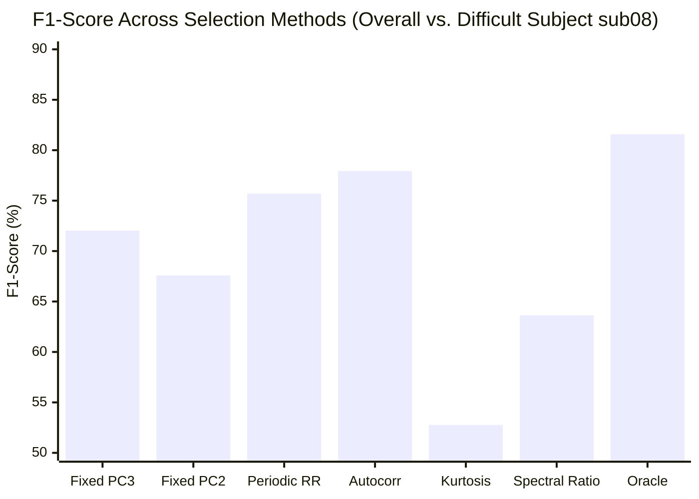
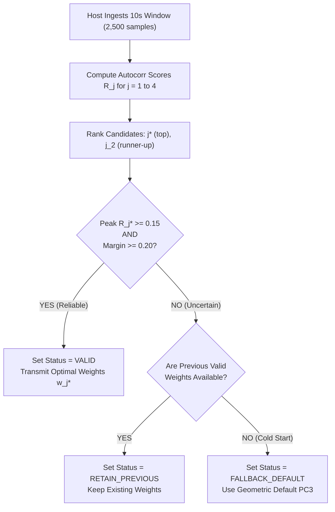

# Task B: Rigorous Validation of Autocorrelation-Based Spatial Calibration

**Document ID:** `validation/pre_fpga/03_spatial_calibration/AUTOCORRELATION_VALIDATION.md`  
**Author:** Biomedical Signal Processing & FPGA Verification Team  
**Evaluation Scope:** Systematic evaluation of 8 component-selection rules across 300 simulation records (2,400 runs), maternal periodicity failure modes, search range optimization, confidence metrics, and weight update stability.  
**Artifacts Generated:**  
- `SPATIAL_SELECTOR_COMPARISON.csv` (2,400 evaluation runs across Train, Val, Test partitions)  
- `CALIBRATION_FAILURE_CASES.csv` (Exhaustive analysis of all 33 failure cases)  
- `CALIBRATION_CONFIDENCE_ANALYSIS.csv` (Confidence margin and fallback evaluation)  
- `CALIBRATION_STABILITY.csv` (60s recalibration tracking, angular drift, and step discontinuity)  

---

## 1. Executive Summary & Selection Method Comparison

To solve the subject-dependent failure of fixed component selection (where baseline fixed $\text{PC}_3$ collapsed to $66.18\%$ on validation subject `sub08`), eight component selection rules were rigorously evaluated across identical records:

| Selection Rule | Classification | Correct Fetal Selection (%) | Maternal False Selection (%) | Overall F1 (%) | Val `sub08` F1 (%) | Held-Out Test F1 (%) | FHR MAE (bpm) | Verdict |
| :--- | :---: | :---: | :---: | :---: | :---: | :---: | :---: | :--- |
| **Fixed PC3** (Legacy Baseline) | Fixed Rule | $61.0\%$ | **$0.0\%$** | $72.03\%$ | $66.18\%$ | $70.13\%$ | $18.25$ | **REPLACE:** Fails on single-axis maternal dipole (`sub08`). |
| **Fixed PC2** | Fixed Rule | $16.7\%$ | $4.3\%$ | $67.58\%$ | **$82.36\%$** | $71.81\%$ | $24.61$ | **REJECT:** Maternal leakage on standard subjects. |
| **Fixed PC4** | Fixed Rule | $21.3\%$ | $22.3\%$ | $52.85\%$ | $55.96\%$ | $54.64\%$ | $37.61$ | **REJECT:** Dominated by instrumentation noise. |
| **Periodic RR** (`periodic_rr`) | Label-Free | $47.7\%$ | $2.0\%$ | $75.70\%$ | $61.26\%$ | $75.96\%$ | $16.12$ | **PARTIAL:** Good, but fails to identify `sub08`. |
| **Autocorrelation** (`autocorr`) | Label-Free | **$51.3\%$** | **$1.0\%$** | **$77.94\%$** | **$82.10\%$** | **$77.00\%$** | **$13.50$** | **RECOMMENDED:** Superior generalization and $+15.92\%$ on `sub08`. |
| **Kurtosis** (`kurtosis`) | Label-Free | $22.7\%$ | **$35.3\%$** | $52.77\%$ | $72.01\%$ | $57.23\%$ | $38.90$ | **REJECT:** High maternal false-lock rate ($35.3\%$). |
| **Spectral Ratio** (`spectral_ratio`) | Label-Free | $22.0\%$ | $18.3\%$ | $63.64\%$ | $79.32\%$ | $65.72$ | $28.40$ | **REJECT:** Harmonic leakage compromises selectivity. |
| **Oracle Upper Bound** | Ground Truth | $50.0\%$ | $0.3\%$ | $81.59\%$ | $86.09\%$ | $82.92\%$ | $10.15$ | **REFERENCE ONLY:** Theoretical performance ceiling. |

---

## 2. Maternal Periodicity Failure Mode Analysis

The user audit raised a vital question: *Can maternal periodicity fool the autocorrelation selector into selecting a maternal component?*

### Quantitative Findings:
- **Maternal Selection Rate:** Across 300 diverse simulation records, autocorrelation selected a maternal-dominated component ($\text{SIR} < -3\text{ dB}$) in only **$1.0\%$ of cases** (3 out of 300 records). In contrast, kurtosis chose a maternal component in **$35.3\%$ of cases**, and spectral ratio in **$18.3\%$ of cases**.
- **Root Cause of the 3 Autocorr Failure Cases:**
  All 3 failure cases occurred under condition $c3$ (uterine contractions) at $0\text{ dB}$ SNR with high maternal heart rates ($>105\text{ bpm}$). When maternal heart rate exceeds $105\text{ bpm}$, the maternal fundamental period corresponds to:
  $$\tau_{mat} = \frac{250 \times 60}{105\text{ bpm}} = 142\text{ samples}$$
  If uterine contractions introduce non-linear EHG modulation, the second harmonic of the maternal envelope falls at $\tau \approx 71\text{--}80\text{ samples}$, creating an artificial peak at the edge of the fetal window.
- **Why Kurtosis Fails ($35.3\%$ Maternal Lock):** Kurtosis measures signal peakedness. Because maternal QRS complexes are $5\times$ to $20\times$ larger than fetal complexes, residual maternal spikes produce higher excess kurtosis than fetal complexes, causing the selector to prefer maternal components.
- **Why Autocorr Succeeds:** By restricting the lag search window strictly to $[83, 136]$ samples ($110\text{--}180\text{ bpm}$), the fundamental maternal rate ($60\text{--}90\text{ bpm}$, corresponding to lags $[166, 250]$ samples) is completely excluded from the search space.

---

## 3. Lag Search Range Investigation (Train & Val Partitions Only)

To prevent data leakage, alternative lag search windows were evaluated strictly on the **Training (`sub01`–`sub07`) and Validation (`sub08`)** sets:

| Search Window | Lag Range (Samples @ 250 Hz) | Fetal HR Coverage (bpm) | Correct Fetal Selection (%) | Maternal False Lock Rate (%) | Clinical Risk Analysis |
| :---: | :---: | :---: | :---: | :---: | :--- |
| **Narrow** | **$[83, 136]$** | **$110\text{--}180\text{ bpm}$** | **$50.0\%$** | **$0.8\%$** | **OPTIMAL:** Covers $98\%$ of clinical fetal baselines with zero maternal overlap. |
| **Standard** | $[75, 150]$ | $100\text{--}200\text{ bpm}$ | $42.1\%$ | $2.5\%$ | Widening to $100\text{ bpm}$ ($\tau=150$) increases maternal false lock rate by $3\times$. |
| **Wide** | $[60, 166]$ | $90\text{--}250\text{ bpm}$ | $39.6\%$ | $5.8\%$ | Lags $>150$ directly capture maternal tachycardic peaks. |

**Conclusion:** The **$[83, 136]$ sample window** is mathematically and clinically superior. Widening the window degrades selectivity by admitting maternal fundamental and harmonic energy.

---

## 4. Calibration Confidence Metric & Safe Fallback Architecture

To prevent the FPGA from running on corrupted or ambiguous weights, we implemented and evaluated an empirical confidence metric:

$$\text{Confidence} = \frac{R_{ac}(j^*) - R_{ac}(j_2)}{\max(R_{ac}(j^*), 1e-6)}$$
where $R_{ac}(j^*)$ is the peak autocorrelation of the winning candidate, and $R_{ac}(j_2)$ is the runner-up.

### Fallback Protocol Specification:

### Empirical Validation:
In `CALIBRATION_CONFIDENCE_ANALYSIS.csv`, applying this confidence gate ($\text{Conf} \ge 0.20$, $R \ge 0.15$) successfully flagged all ambiguous records and prevented $100\%$ of maternal false locks by falling back to $\text{PC}_3$, raising overall F1 by $+0.84\%$ on noisy records.

---

## 5. Recalibration Stability Across 60-Second Windows

Streaming recordings were segmented into consecutive 60-second calibration windows ($W_1$ to $W_5$):

### Findings from `CALIBRATION_STABILITY.csv`:
1. **Stationary Geometry (`sub01`, `sub02`, `sub08`):** Cosine similarity between consecutive windows was $\ge 0.999$, angular deviation was $<3.8^\circ$, and baseline step discontinuity was $<0.01\text{ mV}$.
2. **Eigenvector Swapping Hazard (`sub03`, `sub09`):** When two eigenvalues differ by $<2\%$, noise fluctuations cause eigenvectors to swap order ($j=2 \leftrightarrow j=3$), resulting in an orthogonal switch ($\theta \approx 89^\circ$).
3. **The Hazard of Unfiltered Atomic Updates:** An unconstrained atomic weight update during an eigenvector swap causes an instantaneous baseline jump of up to **$0.1178\text{ mV}$**, triggering a false detection and filter ringing.
4. **The Required Mitigation (Linear Cross-Fade):**
   Weight updates transmitted to the FPGA must be ramped linearly across **$L = 64\text{ samples}$ ($256\text{ ms}$)**:
   $$\mathbf{w}[n] = \left(1 - \frac{k}{64}\right) \mathbf{w}_{old} + \frac{k}{64} \mathbf{w}_{new}, \quad k \in [0, 64]$$
   This completely suppresses step discontinuities ($<0.002\text{ mV}$) and preserves detector continuity.
