# Fixed-Point Numerical Specification: Golden RTL Implementation Format

**Document ID:** `validation/pre_fpga/06_fixed_point/FIXED_POINT_SPECIFICATION.md`  
**Target Hardware:** Spartan-7 XC7S50-1CSGA324C  
**Author:** Biomedical Signal Processing & FPGA Verification Team  
**Governing Code:** `code/src/bit_accurate_reference_model.py`  

---

## 1. Complete Numerical Specification for All 11 Stages

Every processing block in the FPGA datapath is strictly defined with its hardware bitwidth, fractional alignment, signedness, rounding rule, and overflow behavior:

```mermaid
flowchart LR
    ADC["1. ADC Input\nSigned 16-bit Q1.15"] --> Beam["2. Beamformer\nAcc: Signed 32-bit Q2.30\nOut: Signed 24-bit Q1.23"]
    Beam --> HP1["3. HP1 Filter\nAcc: Signed 32-bit\nOut: Signed 24-bit Q1.23"]
    HP1 --> LP40["4. LP40 Filter (FECG)\nCoeffs: Signed 18-bit Q3.15\nStates: Signed 48-bit\nOut: Signed 24-bit Q1.23"]
    LP40 --> BP["5. Detector BP (12-35 Hz)\nCoeffs: Signed 18-bit Q3.15\nStates: Signed 48-bit\nOut: Signed 16-bit Q1.15"]
    BP --> Squarer["6. Squarer\nUnsigned 32-bit u32"]
    Squarer --> MWI["7. MWI Ring Buffer\nUnsigned 36-bit u36\nW = 30 samples"]
    MWI --> Thresh["8. Dual-Threshold FSM\nUnsigned 36-bit u36\n1/8 EMA shifts"]
    Thresh --> Peak["9. Local Search Window\nTrailing 26 samples s16\nPeak timestamp"]
    Peak --> RR["10. RR Interval Engine\nUnsigned 9-bit (60 to 300)"]
    RR --> FHR["11. FHR Output & Telemetry\nUnsigned 12-bit (bpm x 10)\n2-bit State Tag"]
```

---

## 2. Definitive Stage-by-Stage Format Table

| Stage Number | Block Name | Input Format | Output Format | Internal Accumulator | Binary Point (Frac Bits) | Coefficient Format | Rounding Method | Saturation Clamp Behavior |
| :---: | :--- | :---: | :---: | :---: | :---: | :---: | :--- | :--- |
| **1** | **Input ECG Stream** | Signed 16-bit | Signed 16-bit | N/A | $\mathbb{Q}_{1.15}$ | N/A | Direct ADC Latch | Saturated $[-32768, +32767]$ |
| **2** | **Spatial Beamformer** | $4\times \mathbb{Q}_{1.15}$ | Signed 24-bit ($\mathbb{Q}_{1.23}$) | Signed 32-bit ($\mathbb{Q}_{2.30}$) | $\mathbb{Q}_{1.23}$ ($s24$) | $4\times \mathbb{Q}_{1.15}$ | Round-half-up >>> 7 | Clamped to $[-2^{23}, 2^{23}-1]$ |
| **3** | **HP1 Baseline Filter**| Signed 24-bit | Signed 24-bit ($\mathbb{Q}_{1.23}$) | Signed 32-bit ($\mathbb{Q}_{9.23}$) | $\mathbb{Q}_{1.23}$ ($s24$) | Shift-only ($k=6$) | Direct truncation on shift | Clamped to $[-2^{23}, 2^{23}-1]$ |
| **4** | **LP40 Low-Pass Filter** | Signed 24-bit | Signed 24-bit ($\mathbb{Q}_{1.23}$) | Signed 48-bit ($\mathbb{Q}_{7.41}$) | $\mathbb{Q}_{1.23}$ ($s24$) | Signed 18-bit ($\mathbb{Q}_{3.15}$) | Round-half-up >>> 15 | Clamped to $[-2^{23}, 2^{23}-1]$ |
| **5** | **Detector BP (12-35 Hz)**| Signed 24-bit | Signed 16-bit ($\mathbb{Q}_{1.15}$) | Signed 48-bit ($\mathbb{Q}_{7.41}$) | $\mathbb{Q}_{1.15}$ ($s16$) | Signed 18-bit ($\mathbb{Q}_{3.15}$) | Round-half-up >>> 8 | Clamped to $[-32768, +32767]$ |
| **6** | **Squaring Multiplier** | Signed 16-bit | Unsigned 32-bit | Single DSP48 Mult | $\mathbb{Q}_{2.30}$ ($u32$) | Self-product ($x \cdot x$) | N/A (Exact product) | Unsigned wrap-proof ceiling |
| **7** | **MWI Ring Buffer Sum** | Unsigned 32-bit | Unsigned 36-bit | Unsigned 36-bit | $\mathbb{Q}_{6.30}$ ($u36$) | N/A (Trailing sum $W=30$)| Exact addition/subtraction | Accumulator range $\le 30 \times 2^{30}$ |
| **8** | **Adaptive Dual-Threshold**| Unsigned 36-bit | Unsigned 36-bit | Unsigned 36-bit | $\mathbb{Q}_{6.30}$ ($u36$) | Shift constants ($1/4, 3/4, 1/8$)| Direct shift truncation | Monotonic update ($P > N$) |
| **9** | **Peak Localizer** | Signed 16-bit | 18-bit Timestamp | 16-bit Comparator | Integer Index | N/A (Lookback $W=26$) | Max-value latching | Sample index roll-over at $2^{18}$ |
| **10** | **RR Interval Engine** | Sample Index | Unsigned 9-bit | 9-bit Subtractor | Samples ($60\text{ to }300$) | N/A | Subtraction ($t_R[n] - t_R[n-1]$)| Clamped/flagged outside $[60, 300]$ |
| **11** | **FHR & Beat Quality** | Unsigned 9-bit | Unsigned 12-bit | 12-bit BRAM Output | $\text{bpm} \times 10$ ($500\text{ to }2500$) | 241-word ROM | Division LUT ($150,000 / RR$) | Held at last valid if out-of-range |

---

## 3. Detailed Arithmetic Equations for RTL Construction

### Stage 2: Spatial Beamformer
$$\text{acc}[n] = \sum_{c=0}^3 w_c \cdot x_c[n]$$
$$y_{proj}[n] = \text{sat}_{s24}\left(\left(\text{acc}[n] + 2^6\right) \gg 7\right)$$

### Stage 3: HP1 Baseline Remover (Must use 32-bit Accumulator)
$$base[n] = acc_{hp}[n-1] \gg 6$$
$$y_{hp}[n] = \text{sat}_{s24}(y_{proj}[n] - base[n])$$
$$acc_{hp}[n] = acc_{hp}[n-1] + y_{proj}[n] - base[n]$$

### Stages 4 & 5: Direct Form II Transposed Biquad Section
For each biquad section $k$ with coefficients $(b_0, b_1, b_2, -a_1, -a_2)$ in $\mathbb{Q}_{3.15}$:
$$y_k[n] = \text{sat}_{s24}\left(\left(b_0 \cdot x_k[n] + s_1[n-1] + 2^{14}\right) \gg 15\right)$$
$$s_1[n] = b_1 \cdot x_k[n] + (-a_1) \cdot y_k[n] + s_2[n-1]$$
$$s_2[n] = b_2 \cdot x_k[n] + (-a_2) \cdot y_k[n]$$

### Stage 7: Moving Window Integrator
$$run\_sum[n] = run\_sum[n-1] + z_{16}^2[n] - z_{16}^2[n-30]$$

### Stage 8: Adaptive Dual-Threshold FSM
$$\text{thr}[n] = (peak[n] \gg 2) + noise[n] - (noise[n] \gg 2)$$
- If candidate beat declared:
  $$peak[n] = peak[n-1] + ((v - peak[n-1]) \gg 3)$$
- Else:
  $$noise[n] = noise[n-1] + ((v - noise[n-1]) \gg 3)$$

This specification is complete, mathematically closed, and directly implementable in Verilog/VHDL.
