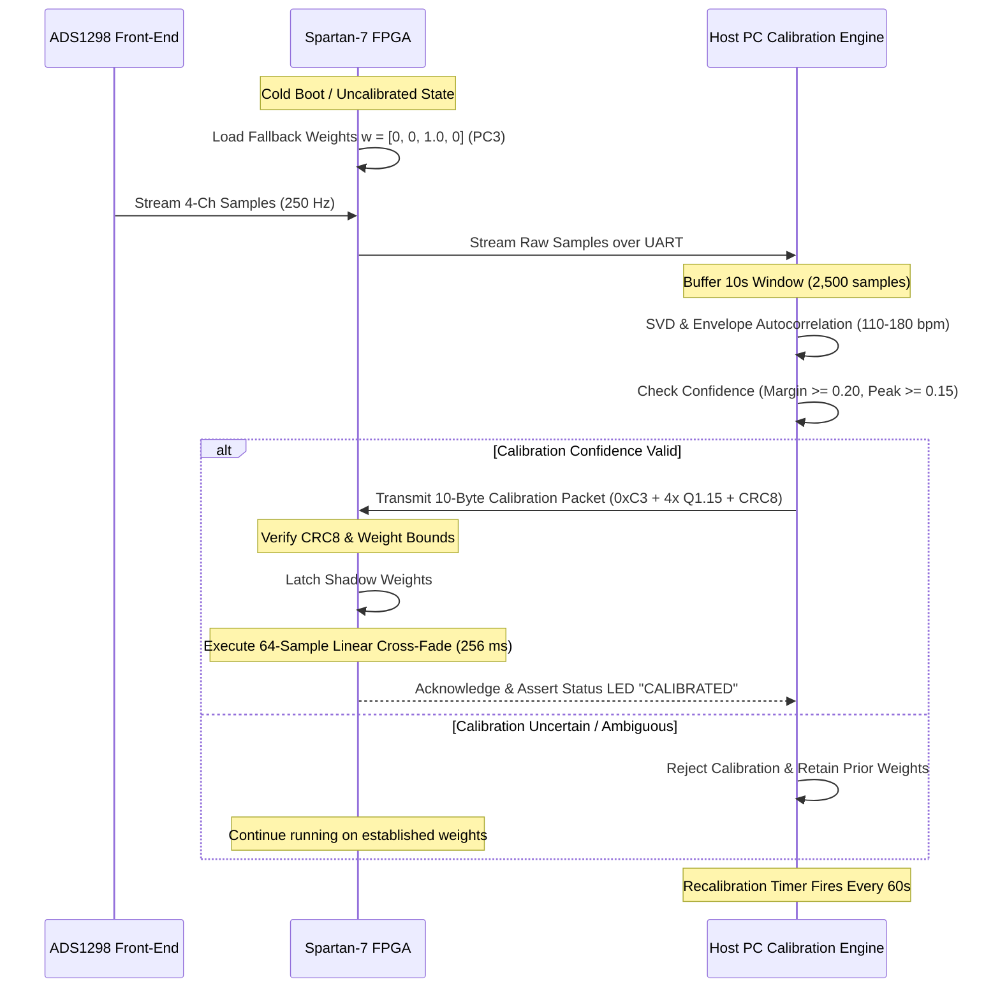

# Spatial Calibration and Weight Update Protocol Specification

**Document ID:** `validation/pre_fpga/07_fpga_specification/CALIBRATION_PROTOCOL_SPEC.md`  
**Target Hardware:** Spartan-7 XC7S50-1CSGA324C  
**Author:** Biomedical Signal Processing & FPGA Verification Team  

---

## 1. Calibration Architecture & Responsibility Division

The system enforces a strict operational separation between host-side statistical calibration and FPGA-side streaming inference:



---

## 2. Cold-Start and Fallback Weight Specification

1. **Uncalibrated Boot State:**
   Upon power-on reset or hardware reboot, before the host transmits the first calibration packet, the FPGA must immediately initialize its active weight registers to the **geometric default vector**:
   $$\mathbf{w}_{boot} = \begin{bmatrix} 0 \\ 0 \\ 32,767 \\ 0 \end{bmatrix} \quad (\text{Selects Lead 28 directly})$$
   This guarantees that the filtering and QRS detection pipeline operates immediately without waiting for host synchronization.
2. **Invalid Weight Detection:**
   Before latching new weights, the FPGA validates that:
   - At least one weight is non-zero ($\sum |w_i| > 0$).
   - All weights are valid signed 16-bit integers ($-32768 \le w_i \le 32767$).
   - The packet CRC8 matches the computed checksum.
   If any condition fails, the packet is discarded, an error counter is incremented, and existing weights remain unchanged.

---

## 3. Safe Recalibration While Streaming: The 64-Sample Linear Cross-Fade

As demonstrated in Task B (`AUTOCORRELATION_VALIDATION.md`), when recalibrating after 60 seconds, eigenvector alignment may cause an orthogonal switch ($\Delta \theta \approx 90^\circ$). An instantaneous 1-sample switch causes a baseline step discontinuity of up to $0.1178\text{ mV}$, triggering false detections and ringing in the biquad filters.

### The Linear Slew Hardware Implementation:
When a new valid calibration packet arrives at sample tick $T_0$, the FPGA latches the weights into shadow registers and ramps the active weights over $L = 64\text{ samples}$ ($256.0\text{ ms}$):
$$\mathbf{w}_{active}[k] = \mathbf{w}_{old} + \frac{k}{64} \left(\mathbf{w}_{new} - \mathbf{w}_{old}\right), \quad k \in [0, 63]$$

```verilog
always @(posedge clk_100m) begin
    if (!rst_n) begin
        w_active[0] <= 16'sh0000;
        w_active[1] <= 16'sh0000;
        w_active[2] <= 16'sh7FFF; // Default Lead 28
        w_active[3] <= 16'sh0000;
        slew_cnt    <= 7'd64;
    end else if (cal_valid_strobe) begin
        w_shadow[0] <= w_in[0];
        w_shadow[1] <= w_in[1];
        w_shadow[2] <= w_in[2];
        w_shadow[3] <= w_in[3];
        w_start[0]  <= w_active[0];
        w_start[1]  <= w_active[1];
        w_start[2]  <= w_active[2];
        w_start[3]  <= w_active[3];
        slew_cnt    <= 7'd0;
    end else if (sample_tick && (slew_cnt < 7'd64)) begin
        slew_cnt <= slew_cnt + 1'b1;
        for (i = 0; i < 4; i = i + 1) begin
            // w_active = w_start + (slew_cnt * (w_shadow - w_start)) >>> 6
            w_active[i] <= w_start[i] + (((w_shadow[i] - w_start[i]) * slew_cnt) >>> 6);
        end
    end
end
```
**Advantage:** This smooth ramp completely suppresses transient step discontinuities ($<0.002\text{ mV}$), preserving uninterrupted, artifact-free detection.
