# FPGA Architecture Specification: Real-Time Multi-Channel Fetal ECG Processor

**Document ID:** `validation/pre_fpga/07_fpga_specification/FPGA_ARCHITECTURE_SPEC.md`  
**Target Device:** AMD/Xilinx Spartan-7 XC7S50-1CSGA324C (RealDigital Boolean Board)  
**System Clock:** $100.0\text{ MHz}$ ($T_{clk} = 10.0\text{ ns}$)  
**Sampling Rate:** $f_s = 250\text{ Hz}$ ($T_s = 4.0\text{ ms} = 400,000\text{ clock cycles}$)  
**Baud Rate:** $921,600\text{ baud}$ (8-N-1)  

---

## 1. System Architecture Overview & Top-Level Diagram

The system implements a real-time streaming pipeline that receives 4-channel abdominal ECG samples, applies spatial beamforming, removes baseline drift, filters out high-frequency noise, detects fetal QRS events, and computes the fetal heart rate with beat quality telemetry:

```mermaid
flowchart TD
    subgraph Host_Domain ["Host PC Domain (Python / C++)"]
        H_Init["10s Calibration Data Buffer (2,500 samples)"] --> H_Cov["Sample Covariance (4x4)"]
        H_Cov --> H_Eig["Eigen-decomposition (SVD)"]
        H_Eig --> H_Auto["Envelope Autocorrelation Selector (110-180 bpm)"]
        H_Auto --> H_Conf{"Confidence Margin >= 0.20\nAND Peak >= 0.15?"}
        H_Conf -->|"YES"| H_Pkt["Build 10-byte Calibration Packet (0xC3 + 4x Q1.15 + CRC8)"]
        H_Conf -->|"NO"| H_Fall["Fallback to Prior Weights or PC3"]
        H_Fall --> H_Pkt
    end

    subgraph FPGA_Domain ["Spartan-7 FPGA XC7S50 Top-Level (100 MHz Single Clock Domain)"]
        UART_RX["1. UART Receiver\n(921,600 baud, 8-N-1)"] --> Parser["2. Input Packet Parser\n(Header Detection & CRC Check)"]
        H_Pkt -.->|"UART Line"| UART_RX
        
        Parser -->|"Calibration Packets"| Weight_RAM["4. Calibration Weight Storage\n(Active & Shadow 16-bit Registers\n64-sample Linear Cross-Fade)"]
        Parser -->|"Sample Packets"| In_Buffer["3. 4-Channel Sample Buffer\n(4x 16-bit Signed Q1.15)"]
        
        In_Buffer --> Beam["5. Spatial Beamformer\ny = w^T * x\n(4x DSP48E1 Multipliers, s24)"]
        Weight_RAM --> Beam
        
        Beam --> HP1["6. HP1 Baseline Remover\n(k=6, 32-bit Acc, s24 Out)"]
        HP1 --> LP40["7. LP40 Filter (40 Hz)\n(2 Biquads, 48-bit States, s24 Out)"]
        LP40 --> Clean_Telemetry["Clean FECG Output Stream"]
        
        LP40 --> BP12_35["8. Detector Bandpass Filter\n(12-35 Hz, 4 Biquads, s16 Out)"]
        BP12_35 --> Squarer["9. Squaring Multiplier\n(z16 * z16 -> u32)"]
        Squarer --> MWI["10. Moving Window Integrator\n(W=30 samples, 36-bit Ring Sum)"]
        
        MWI --> Threshold_FSM["11. Adaptive Dual-Threshold FSM\n(1/8 EMA shifts, 200 ms Refractory)"]
        Threshold_FSM --> Localizer["12. Peak Localizer & Latency Subtractor\n(Trailing 26-sample Search, -12 smp)"]
        
        Localizer --> FHR_Engine["13. RR Engine & Beat Quality Logic\n(Interval Fusion + Median5 + 241-entry LUT)"]
        
        FHR_Engine --> UART_TX["14. UART Transmitter & Status Telemetry\n(921,600 baud, QRS/FHR Packets)"]
        Clean_Telemetry --> UART_TX
    end
```

---

## 2. Definitive Specification of All 14 Subsystem Modules

### Module 1: UART Receiver (`uart_rx.v`)
- **Function:** Deserializes asynchronous serial bytes from host at $921,600\text{ baud}$.
- **Inputs:** `clk_100m` (1 bit), `rst_n` (1 bit), `rxd` (1 bit).
- **Outputs:** `rx_data` (8 bits), `rx_valid` (1 bit), `framing_err` (1 bit).
- **Clock Domain:** Synchronous $100.0\text{ MHz}$.
- **Throughput:** $92,160\text{ bytes/sec}$ peak.
- **Latency:** $10.85\ \mu\text{s}$ per byte ($10\text{ bit periods}$).
- **Resources:** $\approx 45\text{ LUTs}$, $52\text{ FFs}$, $0\text{ DSP}$, $0\text{ BRAM}$.

### Module 2: Input Sample Parser (`packet_parser.v`)
- **Function:** Parses incoming byte stream, verifies framing headers (`0xA5` for data, `0xC3` for weights), validates CRC8, and demultiplexes payload.
- **Inputs:** `rx_data` (8 bits), `rx_valid` (1 bit).
- **Outputs:** `sample_valid` (1 bit), `ch0..ch3` (4x 16 bits), `cal_valid` (1 bit), `w0..w3` (4x 16 bits), `crc_err` (1 bit).
- **Internal State:** 12-state reception FSM with CRC8-CCITT accumulator.
- **Resources:** $\approx 85\text{ LUTs}$, $92\text{ FFs}$, $0\text{ DSP}$, $0\text{ BRAM}$.

### Module 3: Four-Channel Sample Buffer (`channel_buffer.v`)
- **Function:** Synchronizes and latches the 4 abdominal ECG channels to a single atomic sample tick.
- **Inputs:** `ch0..ch3` (4x 16 bits), `sample_valid` (1 bit).
- **Outputs:** `x_sync` ($4 \times 16\text{ bits}$ vector), `sample_tick` (1 bit pulse).
- **Throughput:** 1 sample per $4.0\text{ ms}$ ($250\text{ Hz}$).
- **Resources:** $\approx 16\text{ LUTs}$, $64\text{ FFs}$, $0\text{ DSP}$, $0\text{ BRAM}$.

### Module 4: Calibration Weight Storage & Slew Engine (`weight_storage.v`)
- **Function:** Holds active spatial weights in registers; receives shadow weights; applies a **64-sample linear cross-fade transition** upon recalibration to eliminate step discontinuities.
- **Inputs:** `w0..w3` (4x 16 bits), `cal_valid` (1 bit), `sample_tick` (1 bit).
- **Outputs:** `w_active` ($4 \times 16\text{ bits}$ vector), `cal_active_flag` (1 bit).
- **Slew Implementation:** $\mathbf{w}[n] = \mathbf{w}_{old} + \frac{k}{64}(\mathbf{w}_{new} - \mathbf{w}_{old})$ across 64 ticks ($256\text{ ms}$).
- **Resources:** $\approx 95\text{ LUTs}$, $148\text{ FFs}$, $1\text{ DSP48}$ (for ramp multiplier), $0\text{ BRAM}$.

### Module 5: Spatial Beamformer (`spatial_beamformer.v`)
- **Function:** Computes dot-product $y = \sum_{c=0}^3 w_c x_c$, scales by $2^{-7}$, and clamps to Signed 24-bit.
- **Inputs:** `x_sync` (4x 16-bit Q1.15), `w_active` (4x 16-bit Q1.15), `sample_tick` (1 bit).
- **Outputs:** `proj_out` (Signed 24-bit Q1.23), `proj_valid` (1 bit).
- **Arithmetic:** 4 DSP48E1 multipliers $\rightarrow$ 32-bit adder $\rightarrow$ symmetric round-half-up shift >>> 7 $\rightarrow$ saturation clamp to $[-8388608, +8388607]$.
- **Latency:** 3 clock cycles ($30\text{ ns}$).
- **Resources:** $\approx 112\text{ LUTs}$, $148\text{ FFs}$, $4\text{ DSP48E1}$, $0\text{ BRAM}$.

### Module 6: HP1 Baseline Filter (`hp1_filter.v`)
- **Function:** First-order recursive highpass filter ($f_c \approx 0.62\text{ Hz}$, $k=6$).
- **Inputs:** `proj_in` (Signed 24-bit Q1.23), `proj_valid` (1 bit).
- **Outputs:** `hp_out` (Signed 24-bit Q1.23), `hp_valid` (1 bit).
- **Accumulator Bitwidth:** **32-bit signed accumulator** (accommodates $28\text{ bits}$ worst-case DC offset).
- **Latency:** 2 clock cycles ($20\text{ ns}$).
- **Resources:** $\approx 48\text{ LUTs}$, $56\text{ FFs}$, $0\text{ DSP}$, $0\text{ BRAM}$.

### Module 7: LP40 Low-Pass Filter (`lp40_filter.v`)
- **Function:** 4th-order Butterworth low-pass filter at $40.0\text{ Hz}$ (2 cascaded Direct Form II Transposed biquads).
- **Inputs:** `hp_in` (Signed 24-bit Q1.23), `hp_valid` (1 bit).
- **Outputs:** `fecg_clean` (Signed 24-bit Q1.23), `lp_valid` (1 bit).
- **Coefficients:** Signed 18-bit $\mathbb{Q}_{3.15}$ stored in registers.
- **Internal States:** 48-bit accumulators per biquad.
- **Latency:** 4 clock cycles ($40\text{ ns}$).
- **Resources:** $\approx 284\text{ LUTs}$, $312\text{ FFs}$, $0\text{ DSP}$ (using time-shared DSPs) or $4\text{ DSP48}$, $0\text{ BRAM}$.

### Module 8: Detector Bandpass Filter (`bp12_35_filter.v`)
- **Function:** 4th-order Butterworth bandpass filter ($12.0\text{--}35.0\text{ Hz}$, Config C, 4 cascaded biquads).
- **Inputs:** `fecg_in` (Signed 24-bit Q1.23), `lp_valid` (1 bit).
- **Outputs:** `bp_out` (Signed 16-bit Q1.15 via shift >>> 8 and clamp), `bp_valid` (1 bit).
- **Internal States:** 48-bit accumulators per biquad.
- **Latency:** 8 clock cycles ($80\text{ ns}$).
- **Resources:** $\approx 568\text{ LUTs}$, $624\text{ FFs}$, $0\text{ BRAM}$.

### Module 9: Squaring Unit (`squarer.v`)
- **Function:** Instantaneous energy computation $z^2 = x \times x$.
- **Inputs:** `bp_in` (Signed 16-bit Q1.15), `bp_valid` (1 bit).
- **Outputs:** `sq_out` (Unsigned 32-bit $\mathbb{Q}_{2.30}$), `sq_valid` (1 bit).
- **Hardware:** Single DSP48E1 multiplier configured for $17\times 17$ unsigned product.
- **Latency:** 1 clock cycle ($10\text{ ns}$).
- **Resources:** $\approx 8\text{ LUTs}$, $36\text{ FFs}$, $1\text{ DSP48E1}$, $0\text{ BRAM}$.

### Module 10: Moving Window Integrator (`mwi_ring.v`)
- **Function:** Trailing rectangular moving window energy integration of length $W = 30\text{ samples}$ ($120.0\text{ ms}$).
- **Inputs:** `sq_in` (Unsigned 32-bit), `sq_valid` (1 bit).
- **Outputs:** `xint_out` (Unsigned 36-bit), `xint_valid` (1 bit).
- **Storage:** 30-word $\times$ 32-bit distributed LUT RAM ring buffer.
- **Equation:** $run\_sum = run\_sum + sq_{new} - sq_{old}$.
- **Latency:** 2 clock cycles ($20\text{ ns}$).
- **Resources:** $\approx 78\text{ LUTs}$, $124\text{ FFs}$, $0\text{ DSP}$, $0\text{ BRAM}$.

### Module 11: Adaptive Dual-Threshold FSM (`threshold_fsm.v`)
- **Function:** Pan-Tompkins adaptive threshold tracking with $1/8$ EMA shifts, 512-sample warm-up, and 50-sample ($200\text{ ms}$) refractory period.
- **Inputs:** `xint_in` (Unsigned 36-bit), `xint_valid` (1 bit).
- **Outputs:** `candidate_tick` (1 bit), `thr_level` (36 bits), `warmup_done` (1 bit).
- **Threshold Rule:** $\text{thr} = (\text{peak} \gg 2) + \text{noise} - (\text{noise} \gg 2)$.
- **Resources:** $\approx 94\text{ LUTs}$, $110\text{ FFs}$, $0\text{ DSP}$, $0\text{ BRAM}$.

### Module 12: Peak Localizer & Latency Subtractor (`peak_localizer.v`)
- **Function:** Searches trailing 26-sample circular buffer for maximum absolute amplitude $|z_{16}|$; subtracts 12-sample group delay compensation.
- **Inputs:** `candidate_tick` (1 bit), `bp_abs` (Unsigned 16-bit), `sample_cnt` (18 bits).
- **Outputs:** `peak_declared_pulse` (1 bit), `peak_timestamp` (18 bits).
- **Equation:** $t_R = t_{local\_max} - 12\text{ samples}$.
- **Latency:** 27 clock cycles ($270\text{ ns}$).
- **Resources:** $\approx 55\text{ LUTs}$, $68\text{ FFs}$, $0\text{ DSP}$, $0\text{ BRAM}$.

### Module 13: RR Engine & Beat Quality Processor (`fhr_engine.v`)
- **Function:** Measures RR intervals; executes safe interval fusion ($RR < 60\text{ samples}$); calculates FHR via 241-word LUT; applies causal Median5 filter; encodes 2-bit state classification.
- **Inputs:** `peak_declared_pulse` (1 bit), `peak_timestamp` (18 bits).
- **Outputs:** `fhr_bpm_x10` (Unsigned 12-bit), `rr_samples` (9 bits), `beat_flag` (2 bits), `fhr_valid` (1 bit).
- **Storage:** 241-word $\times$ 12-bit BRAM ROM (0.5 RAMB18).
- **Resources:** $\approx 82\text{ LUTs}$, $96\text{ FFs}$, $0\text{ DSP}$, $0.5\text{ BRAM}$.

### Module 14: UART Transmitter & Telemetry Formatter (`uart_tx_telemetry.v`)
- **Function:** Formats telemetry packets and serializes output at $921,600\text{ baud}$.
- **Inputs:** `fhr_bpm_x10`, `peak_timestamp`, `beat_flag`, `fecg_clean`.
- **Outputs:** `txd` (1 bit), `tx_busy` (1 bit).
- **Resources:** $\approx 50\text{ LUTs}$, $62\text{ FFs}$, $0\text{ DSP}$, $0\text{ BRAM}$.

---

## 3. Host vs. FPGA Operational Partition

| Function / Task | Execution Location | Algorithm / Implementation | Justification |
| :--- | :---: | :--- | :--- |
| **Ingestion of Initial 10s Window** | Host PC | Buffered USB / UART stream | Requires circular RAM for SVD |
| **Covariance & Eigen-decomposition** | Host PC | $4\times 4$ LAPACK eigenvalue solver | High complexity, not needed in streaming RTL |
| **Envelope Autocorrelation Selection** | Host PC | FFT-based Autocorrelation ($110\text{--}180\text{ bpm}$) | Runs once at startup and every 60s |
| **Calibration Confidence Check** | Host PC | Peak margin test ($\text{Margin} \ge 0.20$) | Prevents ambiguous weight transmission |
| **Weight Packet Transmission** | Host PC | 10-byte UART packet with CRC8 | Host writes to FPGA register space |
| **Real-Time Streaming Beamforming** | **FPGA** | 4-channel pipelined DSP48 MAC | Real-time continuous processing ($f_s=250\text{ Hz}$) |
| **64-Sample Weight Cross-Fade** | **FPGA** | Linear interpolation FSM | Prevents step discontinuities |
| **Digital Filtering (HP1 + LP40 + BP)** | **FPGA** | Cascaded DF2T IIR Biquads | Sample-by-sample causal processing |
| **QRS Detection & Localizer** | **FPGA** | Pan-Tompkins adaptive threshold FSM | Deterministic $<1.28\ \mu\text{s}$ compute time |
| **Interval Fusion & Median5 FHR** | **FPGA** | Causal 5-word ring buffer + BRAM LUT | Instantaneous clinical telemetry |
| **UART Telemetry Streaming** | **FPGA** | Pipelined UART serializer ($921,600\text{ baud}$) | Continuous $106.13\text{ ms}$ clinical delivery |

*Notice:* Autocorrelation and SVD run **exclusively on the host PC**. The Spartan-7 FPGA receives pre-computed, verified 16-bit projection weights.
