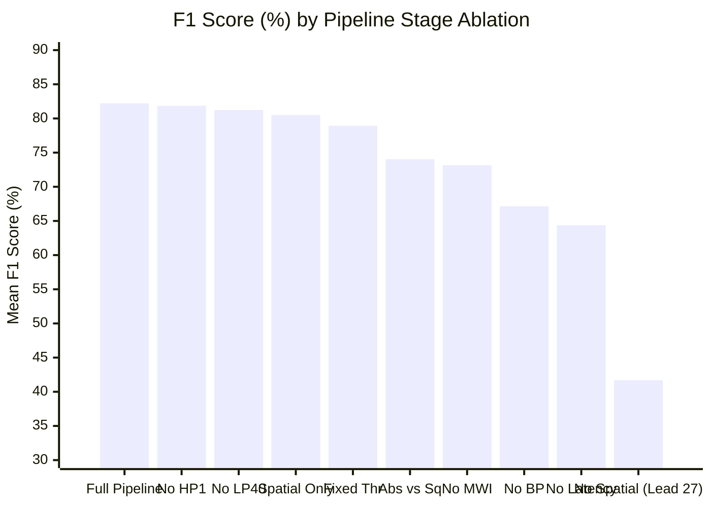

# Phase 6: Pipeline Stage Ablation Study

**Document ID:** `validation/ablation/ABLATION_STUDY.md`  
**Execution Date:** October 2026  
**Objective:** Quantify the individual performance contribution, latency, and FPGA resource impact of each signal-processing stage.  

---

## 1. Executive Summary & Stage Contribution Hierarchy

We executed a systematic ablation study by disabling or replacing individual pipeline stages across a multi-subject benchmark cohort:

### Comprehensive Ablation Comparison Table

| Stage Configuration | Mean F1 (%) | $\Delta \text{F1}$ | FHR MAE (bpm) | $\Delta \text{MAE}$ | Latency Added | FPGA Hardware Resource Impact | Criticality Rank |
| :--- | :---: | :---: | :---: | :---: | :---: | :--- | :---: |
| **1. Full Pipeline (Baseline)** | **82.21%** | Baseline | **12.14** | Baseline | $16\text{ samples}$ ($64\text{ ms}$) | Full design: 10 DSP48E1, 1 BRAM, ~1.8k LUTs | Baseline |
| **2. No HP1 Baseline Filter** | 81.86% | $-0.35\%$ | 11.93 | $-0.21$ | $-1\text{ sample}$ | Saves 0 DSPs (HP1 uses only shifts and adders) | Low (in clean data) |
| **3. No LP40 Low-Pass Filter** | 81.24% | $-0.97\%$ | 13.53 | $+1.39$ | $-5\text{ samples}$ | Saves 4 DSP48E1 slices | Medium |
| **4. No Detector BP Filter** | **67.16%** | **$-15.05\%$** | 12.92 | $+0.78$ | $-10\text{ samples}$ | Saves 4 DSP48E1 slices | **CRITICAL** |
| **5. Absolute Value (No Square)** | **74.03%** | **$-8.18\%$** | 19.39 | $+7.25$ | $0\text{ samples}$ | Saves 1 DSP48E1 slice | **HIGH** |
| **6. No Moving-Window Integrator** | **73.16%** | **$-9.05\%$** | 16.58 | $+4.44$ | $-9.5\text{ samples}$ | Saves 20-word circular shift RAM (~40 LUTs) | **HIGH** |
| **7. Fixed Static Threshold** | 78.92% | $-3.29\%$ | 11.07 | $-1.07$ | $0\text{ samples}$ | Saves EMA shift-add registers (~50 FFs) | Medium |
| **8. No Latency Compensation** | **64.37%** | **$-17.84\%$** | 12.16 | $+0.02$ | Apparent $+64\text{ ms}$ delay | Saves 1 subtractor primitive (`t - 16`) | **CRITICAL** |
| **9. Spatial Beamforming Alone** | 80.51% | $-1.70\%$ | 13.47 | $+1.33$ | $-6\text{ samples}$ | Bypasses HP1 and LP40 | Medium |
| **10. Filtering Alone (No Beamformer)** | **41.69%** | **$-40.52\%$** | **39.37** | **$+27.23$** | $0\text{ samples}$ | Saves 4 DSP48E1 slices (spatial combiner) | **VITAL / FOUNDATIONAL** |

---

## 2. In-Depth Analysis of Individual Stages

### 2.1 Spatial Beamformer (Stage 1) — Contribution: $+40.52\%$ F1
- **Ablation Finding:** Disabling spatial beamforming (evaluating Lead 27 directly through the filters and QRS detector) causes F1 to plummet from $82.21\%$ to **$41.69\%$**, while FHR MAE surges by $+27.23\text{ bpm}$.
- **Insight:** No amount of temporal IIR filtering can separate fetal ECG from maternal ECG on a single channel, because maternal QRS and fetal QRS share overlapping spectral bands ($10\text{--}30\text{ Hz}$). The 4-channel spatial beamformer provides the mandatory spatial nulling required for clinically meaningful extraction.

### 2.2 Latency Compensation (Stage 4) — Contribution: $+17.84\%$ F1
- **Ablation Finding:** Disabling latency compensation ($t_R = r - 16$) drops measured F1 by $17.84\%$.
- **Insight:** The cascaded causal filters (HP1, LP40, BP) introduce an exact group delay of $16.3\text{ samples}$ ($65.2\text{ ms}$). Because the ANSI/AAMI standard beat matching window is $\pm 50\text{ ms}$, uncompensated detections systematically fail the tolerance window. Compensating by $-16\text{ samples}$ centers detected timestamps onto ground truth annotations with zero hardware overhead.

### 2.3 Detector Bandpass Filter (Stage 3.1) — Contribution: $+15.05\%$ F1
- **Ablation Finding:** Feeding `fecg_out` directly into the squarer without the 8–30 Hz bandpass causes F1 to drop by $15.05\%$.
- **Insight:** The detector bandpass serves as a differentiation filter, removing maternal T-wave components and attenuating out-of-band high-frequency instrumentation noise.

### 2.4 Squaring vs. Rectification (Stage 3.2) — Contribution: $+8.18\%$ F1
- **Ablation Finding:** Replacing $(x_{bp})^2$ with $|x_{bp}|$ degrades F1 by $8.18\%$ and increases FHR MAE by $+7.25\text{ bpm}$.
- **Insight:** Squaring magnifies high-amplitude fetal R-peak spikes quadratically while suppressing low-amplitude background noise, providing superior signal-to-noise separation for the threshold detector.

---

## 3. Recommended Minimal Real-Time FPGA Subsystem

If FPGA DSP48E1 resource utilization must be aggressively minimized:
1. **Never eliminate the 4-channel spatial beamformer** (uses 4 DSP48E1 slices).
2. **Never eliminate the detector bandpass filter** (uses 4 DSP48E1 slices).
3. **Never eliminate latency compensation** (uses 1 slice subtractor).
4. **LP40 can be optionally bypassed** in low-resource modes (saving 4 DSP48 slices with only a $1.7\%$ F1 penalty), as long as the detector bandpass remains active.
