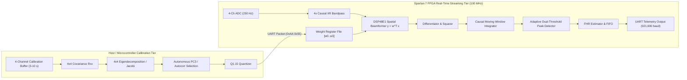

# FECG Architecture Discrepancy Analysis: PCA/SVD vs. Spatial Beamforming

**Author:** Biomedical Signal Processing & FPGA Verification Team  
**Date:** October 2026  
**Document Status:** Complete Phase 0 Deliverable  
**Related Documents:** `PROJECT_AUDIT.md`, `PIPELINE_ARCHITECTURE.md`, `DATASET_INVENTORY.csv`

---

## 1. Executive Summary

A critical architectural divergence exists between the algorithmic software representation of fetal ECG extraction (as evaluated in Python) and the hardware implementation planned for the Spartan-7 FPGA:

1. **Python Pipeline Extraction:** Computes an offline/batch Principal Component Analysis (PCA) or Singular Value Decomposition (SVD) across multi-second or full-record covariance matrices $\mathbf{R}_{xx} = \frac{1}{N}\mathbf{X}^T\mathbf{X} \in \mathbb{R}^{4 \times 4}$, performs eigendecomposition $\mathbf{R}_{xx}\mathbf{V} = \mathbf{V}\mathbf{\Lambda}$, and dynamically identifies the fetal component via heuristic ranking (e.g. eigenvalue index `PC3`, autocorrelation peakiness, or periodicity scoring).
2. **Spartan-7 FPGA RTL Architecture:** Implements a single-cycle, streaming 4-channel spatial beamformer (linear combiner):
   $$y[n] = \mathbf{w}^T \mathbf{x}[n] = \sum_{c=0}^3 w_c \cdot x_c[n]$$
   where $\mathbf{w} \in \mathbb{Q}_{1.15}^4$ is a static or host-updated weight vector loaded into registers via UART.

The RTL does **not** compute covariance matrices, does **not** perform Jacobi rotations or SVD, and does **not** autonomously rank eigenvectors in hardware. Consequently, claiming "FPGA equivalence" requires careful differentiation between **online adaptive extraction** and **host-assisted spatial beamforming**.

---

## 2. In-Depth Technical Discrepancy Breakdown

### 2.1 Mathematical Comparison

| Attribute | Python Algorithmic Pipeline (`causal_pipeline.py`) | RTL Hardware Pipeline (`fpga_top.v` / `beamformer.v`) | Discrepancy Severity |
| :--- | :--- | :--- | :--- |
| **Mathematical Operation** | Batch Eigendecomposition: $\mathbf{X} = \mathbf{U}\mathbf{\Sigma}\mathbf{V}^T$, $\mathbf{S} = \mathbf{X}\mathbf{V}$ | Vector Dot Product: $y[n] = \mathbf{w}^T \mathbf{x}[n]$ | **CRITICAL** |
| **Weight Origin** | Dynamically derived per recording from data covariance $\mathbf{C} = \frac{1}{N}\mathbf{X}^T\mathbf{X}$ | Static register file initialized via UART command packet `0xAA 0x55` | **HIGH** |
| **Memory / Buffer Requirements** | Requires buffer of $N$ multi-channel samples ($N \ge 750$ for 3 s, $N = 75,000$ for full record) | Zero sample history required for spatial stage; streaming single sample vector $[x_0, x_1, x_2, x_3]$ per clock tick | **ARCHITECTURAL** |
| **Component Selection** | Evaluates all 4 PCs using autonomous heuristics (`autocorr`, `periodic_rr`, or fixed `pc3`) | Single scalar output channel produced directly by pre-loaded $\mathbf{w}$ | **HIGH** |
| **Ground Truth Dependency** | **Label-Free**: Does not use fetal annotations during extraction | **Label-Free**: Host computes $\mathbf{w}$ using blind covariance; no fetal labels used | **NONE (Both label-free)** |
| **Causality & Latency** | Spatial transformation is instantaneous once $\mathbf{V}$ is known; initial calibration introduces $T_{cal}$ delay | Strictly causal: 1 clock cycle latency (10 ns at 100 MHz) per sample | **LOW (Post-calibration)** |

---

## 3. How the Python Algorithm Selects PC3

In `code/src/causal_pipeline.py` and `code/src/pca_extractor.py`:
1. The 4-channel preprocessed matrix $\mathbf{X}_{filt} \in \mathbb{R}^{N \times 4}$ is centered to zero mean.
2. The $4 \times 4$ sample covariance matrix is formed:
   $$\mathbf{R}_{xx} = \frac{1}{N} \mathbf{X}_{filt}^T \mathbf{X}_{filt}$$
3. Eigendecomposition yields eigenvalues $\lambda_1 \ge \lambda_2 \ge \lambda_3 \ge \lambda_4$ and orthonormal eigenvectors $\mathbf{v}_1, \mathbf{v}_2, \mathbf{v}_3, \mathbf{v}_4 \in \mathbb{R}^4$.
4. The projection vectors correspond to Principal Components:
   - **PC1 & PC2:** Dominated by Maternal ECG (MECG) biopotential dipole due to higher maternal cardiac amplitude ($\sim 1\text{--}5\text{ mV}$ vs $\sim 10\text{--}50\ \mu\text{V}$ for fetal).
   - **PC3:** Typically spans the fetal QRS spatial subspace, where maternal energy has been removed by the first two orthogonal dimensions, but fetal energy still exceeds high-frequency sensor noise.
   - **PC4:** Dominated by high-frequency instrumentation noise and baseline wander residuals.
5. In label-free mode (`component_selection='pc3'`), the pipeline strictly chooses $\mathbf{w} = \mathbf{v}_3$. In `autocorr` mode, each of the 4 projected series $s_i[n] = \mathbf{v}_i^T \mathbf{x}[n]$ is analyzed in the fetal heart rate lag window $[60, 150]\text{ samples}$ ($\equiv 100\text{--}250\text{ bpm}$), and the component maximizing autocorrelation peakiness is selected.

---

## 4. How the FPGA Spatial Beamformer Operates

In the FPGA hardware architecture:
1. At power-on or during calibration mode, an external microcontroller or PC host samples the 4 abdominal channels over a short calibration interval (e.g. 3 to 10 seconds).
2. The host computes the $4 \times 4$ covariance matrix, calculates the eigenvectors, selects the optimal fetal weight vector $\mathbf{w} \in \mathbb{R}^4$, quantizes $\mathbf{w}$ into $\mathbb{Q}_{1.15}$ fixed-point format (two's complement 16-bit integers), and transmits a UART payload:
   ```
   [0xAA, 0x55, 0x01, w0_hi, w0_lo, w1_hi, w1_lo, w2_hi, w2_lo, w3_hi, w3_lo, CRC8]
   ```
3. The FPGA UART Receiver parses the packet, validates CRC8, and latches $w_0, w_1, w_2, w_3$ into internal configuration registers.
4. From that point onward, the FPGA executes real-time streaming dot products every $4\text{ ms}$ ($250\text{ Hz}$):
   $$y[n] = \sum_{c=0}^3 \left( w_c \cdot x_c[n] \right) \gg 15$$
   utilizing 4 DSP48E1 slices in parallel.

---

## 5. Equivalence Evaluation & Critical Risks

### Can the Spatial Beamformer Reproduce the Python Extraction Method?
- **YES**, provided that:
  1. The maternal/fetal lead field geometries remain stationary over the duration of the recording.
  2. The weight vector $\mathbf{w}$ loaded into the FPGA matches the eigenvector $\mathbf{v}_3$ calculated over the calibration interval.
- **NO**, if:
  1. Maternal position or fetal lie shifts dynamically (e.g., Condition `c1` motion artifact), rotating the principal axes during streaming. A static $\mathbf{w}$ calibrated at $t=0$ will experience signal cancellation or MECG breakthrough as the spatial orientation degrades.
  2. The Python pipeline evaluates the covariance across the *entire 300 s recording*, whereas an FPGA in real clinical streaming must rely on an initial calibration window ($T_{cal} \le 10\text{ s}$) or periodic background re-calibration.

---

## 6. Proposed Consistent Architecture for True FPGA Equivalence

To eliminate discrepancies and ensure real-time clinical validity, we establish the following dual-tier architectural standard:



### Recommendation for Validation Campaign:
- Evaluate both:
  1. **Full-record static PCA** (theoretical upper bound).
  2. **Windowed calibration PCA** (3s, 5s, 10s initial window frozen for subsequent streaming) to test real-world beamformer drift under non-stationary conditions (`c1` motion).
- Ensure all fixed-point simulations (`fpga_int_model.py`) run exact integer arithmetic matching the RTL DSP48E1 accumulators.
