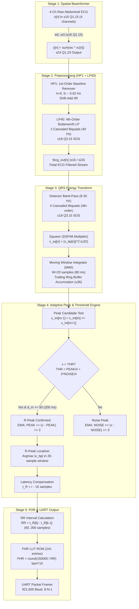

# Real-Time Causal Signal Processing Pipeline Architecture

**Document ID:** `validation/audit/PIPELINE_ARCHITECTURE.md`  
**System Target:** AMD/Xilinx Spartan-7 XC7S50-1CSGA324C (RealDigital Boolean Board)  
**Clock / Sampling Frequency:** 100 MHz System Clock / 250 Hz Biopotential Sampling  

---

## 1. High-Level Architectural Diagram

---

## 2. Stage-by-Stage Specifications

### Stage 1: Spatial Beamforming (Linear Combiner)
- **Input:** 4-channel biopotential vector $\mathbf{x}[n] = [x_0, x_1, x_2, x_3]^T \in \mathbb{R}^4$ in signed 16-bit ($\mathbb{Q}_{1.15}$, full scale $\pm 5\text{ mV}$, $0.1526\ \mu\text{V}/\text{LSB}$).
- **Output:** Scalar projected signal $y[n] \in \mathbb{R}$ in signed 24-bit ($\mathbb{Q}_{1.23}$, 8 fractional guard bits).
- **Mathematical Operation:**
  $$y[n] = \sum_{c=0}^3 w_c \cdot x_c[n]$$
- **Parameters & Coefficients:** Static weights $\mathbf{w} \in \mathbb{Q}_{1.15}^4$ uploaded via UART calibration packet. Product sum shifted: `>> 7` (from $\mathbb{Q}_{2.30}$ to $\mathbb{Q}_{1.23}$).
- **Causality:** Strictly causal ($0$ sample lookahead).
- **Latency / Delay:** 1 clock cycle ($10\text{ ns}$ at $100\text{ MHz}$).
- **FPGA Resources:** 4 DSP48E1 slices in parallel.

---

### Stage 2: Causal Preprocessing Filter Chain (HP1 + LP40)

#### 2.1 High-Pass Baseline Remover (HP1)
- **Input:** $y[n]$ ($\mathbb{Q}_{1.23}$, 24-bit signed).
- **Output:** $y_{hp}[n]$ ($\mathbb{Q}_{1.23}$, 24-bit signed).
- **Mathematical Operation:**
  $$B[n] = B[n-1] + 2^{-k}\left(y[n] - B[n-1]\right)$$
  $$y_{hp}[n] = y[n] - B[n-1]$$
- **Parameters:** $k = 6$, corresponding to $-3\text{ dB}$ cutoff $f_c \approx \frac{f_s}{2\pi 2^k} = \frac{250}{2\pi \cdot 64} \approx 0.6217\text{ Hz}$.
- **Causality:** Strictly causal recursive 1st-order IIR.
- **Latency / Delay:** Phase delay $\approx 1\text{ sample}$ ($4\text{ ms}$).
- **FPGA Implementation:** Arithmetic right shifts (`>>> 6`) and adders; 0 DSP slices, purely slice LUTs/FFs.

#### 2.2 Low-Pass Filter (LP40)
- **Input:** $y_{hp}[n]$ ($\mathbb{Q}_{1.23}$, 24-bit signed).
- **Output:** $fecg[n]$ ($\mathbb{Q}_{1.23}$ / $\mathbb{Q}_{1.15}$, 16-bit truncated for detector).
- **Mathematical Operation:** 4th-order Butterworth low-pass filter at $40\text{ Hz}$, factored into 2 second-order sections (SOS / Biquads) in Direct Form II Transposed:
  $$w_i[n] = x_i[n] - a_{i,1} w_i[n-1] - a_{i,2} w_i[n-2]$$
  $$y_i[n] = b_{i,0} w_i[n] + b_{i,1} w_i[n-1] + b_{i,2} w_i[n-2]$$
- **Parameters:** Coefficients represented in $\mathbb{Q}_{3.15}$ (18 bits).
- **Causality:** Strictly causal.
- **Latency / Delay:** Group delay $\tau_{g,LP} \approx 4.8\text{ samples}$ ($19.2\text{ ms}$).
- **FPGA Implementation:** 2 biquads sequenced across DSP48E1 slices.

---

### Stage 3: QRS Energy Detection Transform (BP + Square + MWI)

#### 3.1 Detector Band-Pass Filter (BP 8–30 Hz)
- **Input:** $fecg[n]$ truncated to signed 16-bit ($\mathbb{Q}_{1.15}$).
- **Output:** $x_{bp}[n]$ signed 16-bit ($\mathbb{Q}_{1.15}$).
- **Mathematical Operation:** 4th-order Butterworth bandpass filter ($8\text{--}30\text{ Hz}$), factored into 4 cascaded biquads (SOS).
- **Parameters:** 4 SOS sections, coefficients in $\mathbb{Q}_{3.15}$.
- **Causality:** Strictly causal.
- **Latency / Delay:** Group delay $\tau_{g,BP} \approx 10.5\text{ samples}$ ($42.0\text{ ms}$ at $15\text{ Hz}$).
- **Total Filter Group Delay:** $\tau_{g,tot} \approx 1 + 4.8 + 10.5 \approx 16.3\text{ samples}$ ($\approx 65.2\text{ ms}$).

#### 3.2 Squaring Operator
- **Input:** $x_{bp}[n]$ ($s16$).
- **Output:** $x_{sq}[n] = (x_{bp}[n])^2$ ($u32$ unsigned 32-bit).
- **Causality:** Strictly causal, 1 clock latency.

#### 3.3 Trailing Moving Window Integrator (MWI)
- **Input:** $x_{sq}[n]$ ($u32$).
- **Output:** $x_{int}[n] = \sum_{k=0}^{W-1} x_{sq}[n-k]$ ($u36$ unsigned accumulator).
- **Parameters:** Window width $W = 20\text{ samples}$ ($80\text{ ms}$).
- **Algorithm:** Circular ring buffer accumulator:
  $$x_{int}[n] = x_{int}[n-1] + x_{sq}[n] - x_{sq}[n-20]$$
- **Causality:** Strictly causal trailing window. Centroid delay = $(W-1)/2 = 9.5\text{ samples}$.

---

### Stage 4: Adaptive Threshold & Decision Logic

- **Candidate Peak Detection:** A local maximum in $x_{int}$ satisfies:
  $$x_{int}[m-1] < x_{int}[m] \quad \text{and} \quad x_{int}[m] \ge x_{int}[m+1]$$
  Declared at sample index $n_{decl} = m + 1$ (1 sample lookahead).
- **Warmup Period:** $512\text{ samples}$ ($2.048\text{ s}$). Peak and Noise thresholds are seeded from the first 512 samples.
- **Threshold Level:**
  $$THR = \frac{1}{4} PEAK + \frac{3}{4} NOISE = (PEAK \gg 2) + NOISE - (NOISE \gg 2)$$
- **Refractory Blanking:** $50\text{ samples}$ ($200\text{ ms} \equiv 300\text{ bpm}$). If $m - m_{last} < 50$, the candidate is blanked.
- **Level Updates (EMA):**
  - If QRS confirmed: $PEAK \leftarrow PEAK + ((v - PEAK) \gg 3)$
  - If noise candidate: $NOISE \leftarrow NOISE + ((v - NOISE) \gg 3)$
- **R-Peak Localizer:** Finds index of $\max |x_{bp}|$ in $[n_{decl}-25, n_{decl}]$.
- **Latency Compensation:**
  $$t_R = r - \text{round}(\tau_{g,tot}) = r - 16\text{ samples}$$

---

### Stage 5: FHR Estimation and Telemetry

- **RR Interval:** $\Delta R[k] = t_R[k] - t_R[k-1]$. Physiological bounds: $60 \le \Delta R \le 300$ samples ($50\text{--}250\text{ bpm}$).
- **Instantaneous FHR:**
  $$FHR_{\times 10} = \text{round}\left( \frac{150,000}{\Delta R} \right)$$
  Synthesized as a 241-entry $\times$ 12-bit Block RAM LUT ROM.
- **UART Framing:** Transmitted at 921,600 baud, 8-N-1:
  - Header: `0x55 0xAA`
  - Payload: Sample index (32-bit), Filtered FECG (16-bit), R-Peak flag (8-bit), Instantaneous FHR (16-bit)
  - Checksum: XOR CRC-8 byte.
