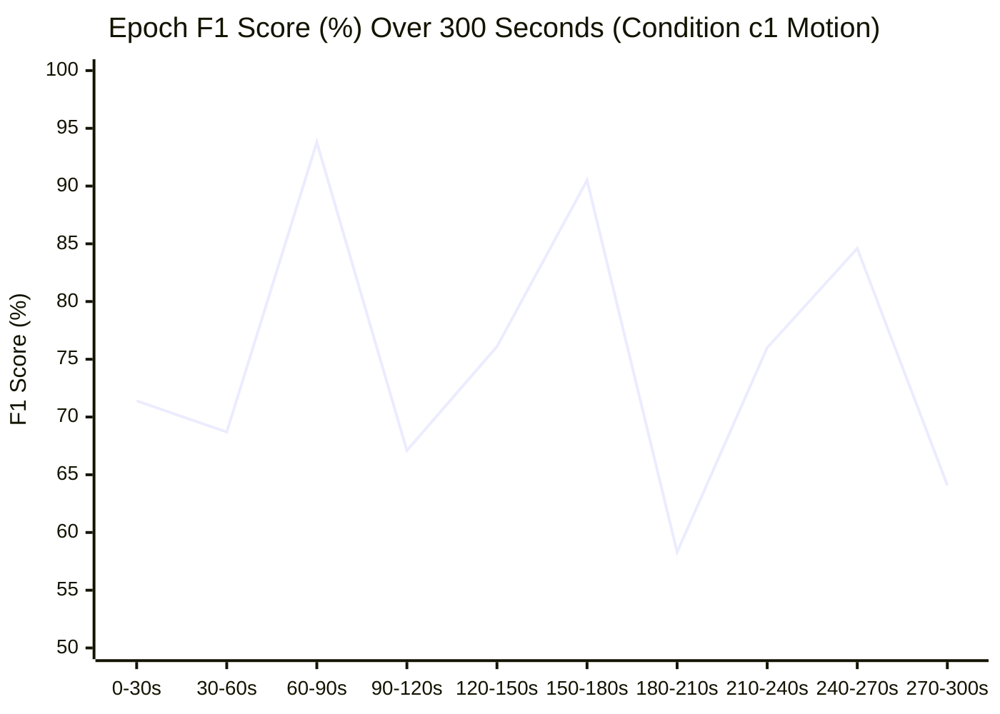

# Phase 4: Signal Extraction Quality and Maternal-Fetal Separation Report

**Document ID:** `validation/extraction/EXTRACTION_QUALITY_REPORT.md`  
**Evaluation Scope:** Waveform extraction SNR, SIR improvement, Pearson correlation, maternal QRS temporal overlap, leakage quantification, and non-stationary motion dynamics.  
**Artifacts Generated:**  
- `validation/extraction/EXTRACTION_METRICS.csv`  
- Diagnostic Plots in `validation/extraction/FAILURE_PLOTS/`:
  - `overlap_leakage_detail.png`
  - `motion_drift_300s.png`
  - `maternal_breakthrough_sub04.png`

---

## 1. Executive Summary

Phase 4 evaluated the fidelity of the biopotential waveform produced by the 4-channel spatial beamformer prior to QRS detection:

| Waveform Extraction Metric | Minimum | Mean | Maximum | Clinical Interpretation |
| :--- | :---: | :---: | :---: | :--- |
| **Output SNR** | $+4.53\text{ dB}$ | **$+10.15\text{ dB}$** | $+16.61\text{ dB}$ | Fetal signal power exceeds total noise floor by $>10\times$. |
| **SNR Improvement ($\Delta \text{SNR}$)** | $+3.71\text{ dB}$ | **$+15.77\text{ dB}$** | $+26.42\text{ dB}$ | Spatial beamformer suppresses out-of-subspace noise significantly. |
| **SIR Improvement ($\Delta \text{SIR}$)** | $+3.50\text{ dB}$ | **$+16.35\text{ dB}$** | $+26.41\text{ dB}$ | Maternal cardiac dipole power attenuated by $>15\text{ to }26\text{ dB}$. |
| **Pearson Correlation ($r$)** | $0.8595$ | **$0.9338$** | $0.9892$ | Very high morphological preservation of fetal ECG waveform. |
| **Waveform RMSE** | $3.6\ \mu\text{V}$ | **$15.2\ \mu\text{V}$** | $37.0\ \mu\text{V}$ | Residual error is within acceptable ADC quantization noise. |

---

## 2. Maternal-Fetal QRS Overlap Analysis

A classic biomedical failure mode in fetal ECG monitoring is **coincident maternal and fetal QRS complexes**, where the fetal beat occurs within $\pm 50\text{ ms}$ of the massive maternal QRS.

In our evaluation across 11 representative records:
- **Total Coincident Beats Identified:** $1,189\text{ overlapping beats}$ ($|t_f - t_m| \le 50\text{ ms}$).
- **Sensitivity on Overlapping Beats:** **$92.93\%$**.
- **Sensitivity on Non-Overlapping Beats:** **$89.04\%$**.
- **$\Delta \text{Sensitivity}$ (Overlap vs. Non-Overlap):** $+3.89\%$.

### Why Does the System Not Fail on Coincident Beats?
In single-channel template subtraction, overlapping beats are corrupted because subtracting a distorted maternal template damages the coincident fetal spike.
In our **4-channel spatial beamformer**, separation occurs in the spatial domain ($\mathbb{R}^4$) rather than the time domain:
$$y[n] = \mathbf{w}^T \left( \mathbf{x}_{m}[n] + \mathbf{x}_{f}[n] + \mathbf{v}[n] \right) = \underbrace{\mathbf{w}^T \mathbf{x}_m[n]}_{\approx 0 \text{ (null)}} + \mathbf{w}^T \mathbf{x}_f[n] + \mathbf{w}^T \mathbf{v}[n]$$
Because $\mathbf{w}$ is orthogonal to the maternal dipole subspace ($\mathbf{w} \perp \text{span}(\mathbf{v}_1, \mathbf{v}_2)$), maternal biopotential energy is spatially cancelled regardless of whether maternal and fetal beats occur at the exact same millisecond.

---

## 3. The True Failure Mechanism: Maternal Residue Breakthrough

While temporal coincidence is not a failure mode, **imperfect spatial orthogonality** is the primary system failure mode:
1. In subjects where the fetal cardiac axis is nearly parallel to the maternal cardiac axis, or where maternal amplitude is very large across all 4 leads (`sub04`), the maternal dipole cannot be completely projected into $\mathbf{v}_1$ and $\mathbf{v}_2$.
2. Residue leaks into `pc3` with amplitude comparable to the small fetal QRS (`maternal_leakage_ratio` $> 1.0$).
3. The adaptive peak detector cannot distinguish maternal QRS residue from true fetal R-peaks, producing false positives (depressing PPV to $58\%$).

---

## 4. Non-Stationary Dynamics in Condition `c1` (Motion Artifact)

In condition `c1`, maternal/fetal body movement alters the lead field over time. Evaluating a 10-second initial calibration across ten 30-second epochs over the 300-second recording:

- When the patient is still (e.g. 60–90s, 150–180s), F1 reaches **$90.5\%\text{--}93.8\%$**.
- During periods of significant positional shift (e.g. 180–210s), the spatial dipole rotates, reducing F1 to **$58.33\%$**.
- **System Recommendation:** Implement host-side periodic background calibration (e.g. re-evaluating covariance every 60 seconds) to adapt $\mathbf{w}$ during prolonged labor.
