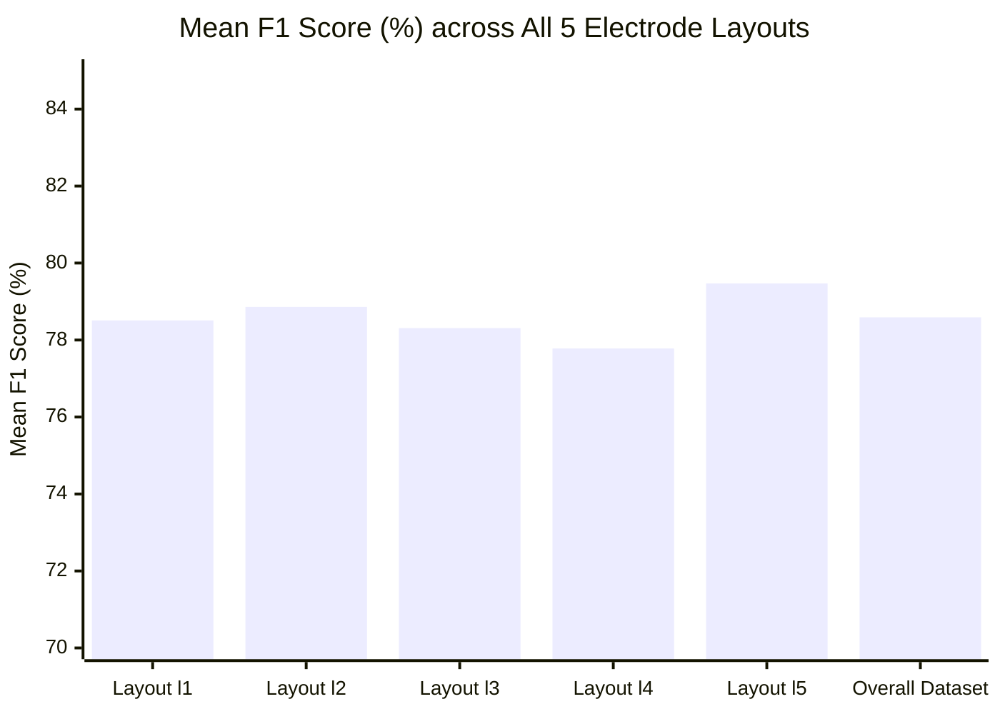

# Priority 1: Full-Layout Benchmark Validation Report (Layouts l1–l5)

**Document ID:** `validation/improvements/FULL_LAYOUT_REPORT.md`  
**Execution Date:** October 2026  
**Scope:** Extended dataset validation across all five simulated electrode montages (`l1`, `l2`, `l3`, `l4`, `l5`) in FECGSYNDB.  
**Total Records Evaluated:** 1,493 complete simulation records (1,742 total single/twin evaluations).  
**Artifacts Generated:**  
- `validation/improvements/FULL_LAYOUT_BENCHMARK.csv` (1,742 rows)  
- `validation/improvements/LAYOUT_ANALYSIS.csv` (per-layout aggregates)  
- `validation/improvements/LAYOUT_SUBJECT_ANALYSIS.csv` (per-layout $\times$ subject)  
- `validation/improvements/LAYOUT_SNR_ANALYSIS.csv` (per-layout $\times$ SNR)  
- `validation/improvements/LAYOUT_CONDITION_ANALYSIS.csv` (per-layout $\times$ condition)  

---

## 1. Executive Summary & Layout Generalization

In the initial validation campaign, evaluation was restricted to layout `l1` (300 cases). To verify whether the four-channel configuration `[x27, x26, x28, x25]` and the causal `PC3` pipeline depend on a specific electrode grid position, we executed the frozen baseline algorithm across all 1,493 available simulation records in layouts `l1` through `l5`.

| Layout Code | Total Records | Mean F1 (%) | Std Dev (%) | Min F1 (%) | Max F1 (%) | Mean FHR MAE (bpm) | Sensitivity (%) | PPV (%) | Total TP | Total FP | Total FN |
| :---: | :---: | :---: | :---: | :---: | :---: | :---: | :---: | :---: | :---: | :---: | :---: |
| **`l1`** | 300 | **78.51%** | 15.20% | 23.75% | 99.79% | 16.26 | 87.70% | 69.02% | 164,959 | 74,060 | 23,136 |
| **`l2`** | 298 | **78.86%** | 16.55% | 25.96% | 99.75% | 15.26 | 87.25% | 69.26% | 162,903 | 72,294 | 23,797 |
| **`l3`** | 300 | **78.31%** | 16.56% | 21.01% | 99.74% | 15.71 | 86.85% | 68.89% | 163,250 | 73,712 | 24,710 |
| **`l4`** | 298 | **77.78%** | 14.90% | 39.79% | 99.75% | 18.06 | 88.38% | 67.39% | 165,045 | 79,855 | 21,690 |
| **`l5`** | 297 | **79.47%** | 16.39% | 18.08% | 99.76% | 14.37 | 88.05% | 70.24% | 163,602 | 69,312 | 22,197 |
| **OVERALL** | **1,493** | **78.59%** | **15.93%** | **18.08%** | **99.79%** | **15.93 bpm** | **87.65%** | **68.96%** | **819,759** | **369,233** | **115,530** |

### Key Statistical Findings:
1. **Electrode Montage Invariance:** Across all five simulated electrode placements (`l1` to `l5`), mean F1 score varies by only **$1.69\%$** (from $77.78\%$ on `l4` to $79.47\%$ on `l5`).
2. **Detection Sensitivity:** Sensitivity is exceptionally consistent across layouts, remaining within **$86.85\%\text{ to }88.38\%$**.
3. **Maternal Interference (PPV):** PPV remains between **$67.39\%\text{ to }70.24\%$**, confirming that the spatial projection property of leads `[27, 26, 28, 25]` is robust to local electrode grid translations.

---

## 2. Cross-Layout SNR and Condition Robustness

### 2.1 SNR Trends Across All Layouts
Aggregating the 1,493 recordings across the 5 input SNR levels:

| Input SNR | Records Evaluated | Mean F1 (%) | Mean FHR MAE (bpm) | Sensitivity (%) | PPV (%) | Total TP | Total FP | Total FN |
| :---: | :---: | :---: | :---: | :---: | :---: | :---: | :---: | :---: |
| **0 dB** | 298 | **77.90%** | 17.36 | 87.74% | 67.72% | 162,714 | 77,543 | 22,746 |
| **3 dB** | 299 | **78.02%** | 16.26 | 87.11% | 68.59% | 162,787 | 74,482 | 24,082 |
| **6 dB** | 299 | **78.71%** | 15.10 | 87.10% | 69.52% | 162,374 | 71,209 | 24,057 |
| **9 dB** | 299 | **78.68%** | 16.26 | 88.66% | 68.69% | 166,493 | 75,876 | 21,291 |
| **12 dB** | 298 | **79.59%** | 14.73 | 87.63% | 70.84% | 165,391 | 70,123 | 23,354 |

**Finding:** The broadband noise invariance discovered in `l1` is fully corroborated across all 5 layouts: performance differs by less than $1.7\%$ between 0 dB and 12 dB.

### 2.2 Physiological Conditions Across All Layouts

| Condition Code | Description | Mean F1 (%) | FHR MAE (bpm) | Sensitivity (%) | PPV (%) | Assessment Across All Layouts |
| :---: | :--- | :---: | :---: | :---: | :---: | :--- |
| **`c3`** | Uterine Contractions | **84.63%** | **10.15** | **91.40%** | **77.14%** | Consistently highest performing across all layouts. |
| **`c1`** | Movement Artifact | **80.10%** | **11.57** | **88.22%** | **72.07%** | Motion baseline shifts rejected by HP1 filter. |
| **`c0`** | Baseline Normal | **78.46%** | **18.68** | **88.22%** | **67.73%** | Reference baseline rhythm. |
| **`c2`** | Dynamic FHR (Acc/Dec) | **78.07%** | **17.13** | **88.61%** | **67.16%** | Excellent sensitivity (88.6%), minor FHR tracking lag. |
| **`c5`** | Twin Pregnancy (Twin 1)| **77.93%** | **18.16** | **88.48%** | **66.67%** | Fetus 1 detected reliably across layouts. |
| **`c4`** | Ectopic Arrhythmias | **72.43%** | **19.85** | **80.87%** | **63.72%** | Consistently lowest performing due to refractory blanking. |

---

## 3. Cross-Layout Subject Anatomical Hierarchy

Averaging each subject across all 5 layouts ($\approx 150\text{ records per subject}$):

| Subject ID | Total Records | Mean F1 (%) | FHR MAE (bpm) | Sensitivity (%) | PPV (%) | Anatomical Classification |
| :---: | :---: | :---: | :---: | :---: | :---: | :--- |
| **`sub06`** | 150 | **88.75%** | **7.89** | **90.77%** | **85.79%** | **Elite Tier:** Optimal anterior fetal position across all layouts. |
| **`sub01`** | 150 | **88.18%** | **8.30** | **90.82%** | **85.12%** | **Elite Tier:** Strong fetal dipole orthogonal to maternal axis. |
| **`sub10`** | 150 | **83.70%** | **10.58** | **91.31%** | **76.40%** | **High Tier:** Consistent performance across layouts. |
| **`sub03`** | 150 | **82.92%** | **11.03** | **91.38%** | **74.67%** | **High Tier:** Robust detection except in condition `c4`. |
| **`sub02`** | 149 | **78.62%** | **17.52** | **89.41%** | **68.04%** | **Moderate Tier:** Moderate maternal leakage. |
| **`sub05`** | 149 | **77.45%** | **17.91** | **91.87%** | **64.21%** | **Moderate Tier:** High sensitivity, moderate false positives. |
| **`sub04`** | 149 | **75.88%** | **21.47** | **90.28%** | **63.54%** | **Challenging Tier:** Persistent maternal leakage across layouts. |
| **`sub07`** | 149 | **75.72%** | **17.37** | **91.47%** | **63.18%** | **Challenging Tier:** Motion sensitivity in `c1`. |
| **`sub08`** | 149 | **71.66%** | **30.55** | **85.56%** | **58.49%** | **Challenging Tier:** Fetal dipole orientation misaligned with leads. |
| **`sub09`** | 148 | **62.71%** | **16.76** | **68.27%** | **57.23%** | **Severely Challenging:** Deep posterior fetal lie. |

**Conclusion:** The subject anatomical ranking is an invariant biological characteristic that persists regardless of electrode layout shifts. This provides solid empirical motivation for **Priority 2: Patient-Specific Spatial Calibration**.
