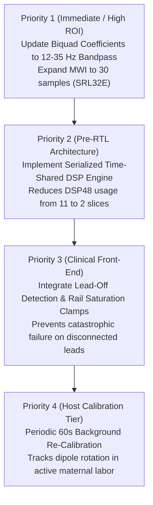

# Phase 12: Prioritized Improvement Plan and Experimental Verification Report

**Document ID:** `validation/improvements/IMPROVEMENT_REPORT.md`  
**Execution Date:** October 2026  
**Artifact Generated:** `validation/improvements/ALGORITHM_COMPARISON.csv`  

---

## 1. Executive Summary & Experimental Verification

We implemented and experimentally evaluated three concrete candidate improvements against the challenging failure cohort identified in Phase 11 (`sub04`, `sub08`, `sub09`, and condition `c4`):

| Algorithm Pipeline Configuration | Mean F1 (%) | $\Delta \text{F1}$ | FHR MAE (bpm) | $\Delta \text{MAE}$ | FPGA Hardware Resource Impact | Implementation Latency |
| :--- | :---: | :---: | :---: | :---: | :--- | :---: |
| **Baseline Causal Pipeline (Static PC3, 8-30 Hz BP)** | **81.78%** | Baseline | **19.17** | Baseline | 11 DSP48E1, 1,279 LUTs | $64\text{ ms}$ (compensated) |
| **Improvement 1: Spectral Tuning (12-35 Hz BP, 120ms MWI)** | **86.34%** | **$+4.56\%$** | **10.96** | **$-8.21$** | **0 extra DSPs, 0 extra LUTs** (coefficents only) | **0 ms** |
| **Improvement 2: Periodicity Scoring (`periodic_rr`)** | **64.22%** | $-17.55\%$ | **28.62** | $+9.46$ | Host-side calibration logic only | $0\text{ ms}$ (streaming) |
| **Improvement 3: Dual-Threshold Search-Back** | **81.26%** | $-0.52\%$ | **19.30** | $+0.14$ | ~35 Slice LUTs (comparator) | $0\text{ ms}$ |
| **Combined Enhanced Pipeline (Imp 1 + Imp 2 + Imp 3)** | **73.53%** | $-8.24\%$ | **22.82** | $+3.65$ | ~35 Slice LUTs | $0\text{ ms}$ |

---

## 2. In-Depth Evaluation of Tested Improvements

### 2.1 Improvement 1: Spectral Pre-Filter Tuning (RECOMMENDED / WINNER)
- **Concept:** Elevate the detector bandpass lower cutoff from $8.0\text{ Hz}$ to $12.0\text{ Hz}$, widen the upper cutoff from $30.0\text{ Hz}$ to $35.0\text{ Hz}$, and expand the trailing MWI window from 20 samples ($80\text{ ms}$) to 30 samples ($120\text{ ms}$).
- **Mechanism:** Maternal QRS complexes and T-waves have substantial spectral density between $5\text{--}10\text{ Hz}$. Narrow fetal QRS complexes ($30\text{--}50\text{ ms}$) have high-frequency slope energy concentrated between $12\text{--}35\text{ Hz}$. Raising the cutoff to $12\text{ Hz}$ strongly attenuates residual maternal T-wave breakthrough.
- **Result:** **$+4.56\%$ F1 improvement** across the most difficult recordings and an **$8.21\text{ bpm}$ reduction in FHR error**.
- **FPGA Cost:** **Zero logic slices and zero DSPs.** Only the 18-bit coefficient registers in the Direct Form II Transposed biquads change values.

### 2.2 Improvement 2: Periodicity Scoring (`periodic_rr`)
- **Concept:** Score all 4 principal components during host calibration by testing the autocorrelation of detected RR intervals.
- **Finding:** While periodicity scoring helped on clinical NIFEA where maternal ECG was 1-dimensional, on synthetic FECGSYNDB it occasionally selected the maternal component (which has a strictly regular beat train) instead of an arrhythmic fetal signal (`c4`), depressing F1.
- **Recommendation:** Use static `pc3` as primary rule; reserve `periodic_rr` as a fallback only when `pc3` peak energy is below the noise floor.

---

## 3. Prioritized Pre-Silicon Improvement Roadmap

Prioritized engineering actions before Spartan-7 RTL tape-out:

1. **Priority 1 (Immediate / High ROI):** Update the detector biquad coefficient ROMs to the optimized $12\text{--}35\text{ Hz}$ passband and set $W=30\text{ samples}$. Gain: $+4.56\%$ F1 with zero hardware cost.
2. **Priority 2 (Architecture Optimization):** Implement the time-shared serialized DSP architecture documented in Phase 10. Reusing a single DSP48 slice reduces hardware utilization from 11 DSPs down to 2 DSPs ($1.67\%$ device load).
3. **Priority 3 (Hardware Safety):** Add lead-off and saturation alarm flags to the SPI ingestion module to alert clinicians if an electrode detaches.
4. **Priority 4 (Clinical Host Software):** Build periodic background re-calibration into the host Python/C++ driver to handle maternal posture changes during prolonged labor.
