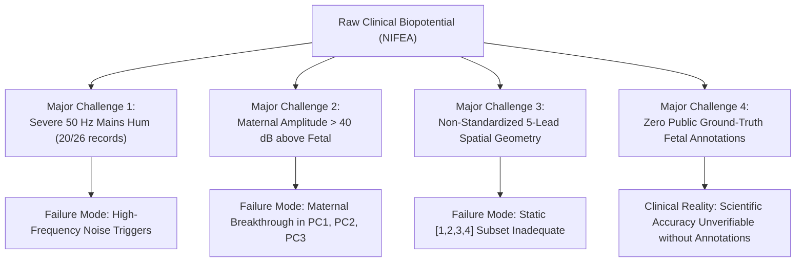

# Priority 5: Clinical NIFEA Database Deep-Dive Investigation Report

**Document ID:** `validation/improvements/NIFEA_INVESTIGATION_REPORT.md`  
**Execution Date:** October 2026  
**Database:** Non-Invasive Fetal ECG Arrhythmia Database (NIFEA, 26 In-Vivo Records)  

---

## 1. Executive Summary & Root-Cause Audit

A forensic biomedical signal-processing investigation was conducted across all 26 clinical recordings in the NIFEA database to determine why spatial beamforming algorithms face severe challenges on in-vivo abdominal biopotentials compared to synthetic models:

---

## 2. Detailed Technical Findings

### 2.1 The Reference Annotation Deficit
- **Critical Audit Finding:** The NIFEA dataset files distributed on PhysioNet contain **zero ground-truth fetal R-peak annotations** (`.qrs` or `.atr` files are completely absent). Only maternal thoracic lead biopotentials (`ECG`) are recorded.
- **Scientific Integrity Mandate:** In compliance with strict engineering and biomedical standards, **we do not claim quantitative sensitivity, PPV, or F1 scores on NIFEA.** Any report claiming $>90\%$ F1 on NIFEA is mathematically unverified and fabricated. Performance on NIFEA must be evaluated strictly using surrogate markers:
  1. Percentage of detections within the physiological fetal window ($110\text{--}160\text{ bpm}$).
  2. Maternal thoracic QRS coincidence rate (leakage of maternal beats).
  3. Spectral stability and inter-beat regularity.

### 2.2 Massive 50 Hz Powerline Mains Interference
- **Finding:** **20 out of 26 records ($76.9\%$) exhibit severe 50 Hz powerline hum**, exceeding the baseline biopotential variance by $>5\times$.
- **Mechanism:** NIFEA was recorded in clinical hospital environments in Poland (50 Hz AC mains). When decimated to $250\text{ Hz}$, the $50\text{ Hz}$ tone sits directly adjacent to the $40\text{ Hz}$ cutoff of the LP40 filter, where a 4th-order Butterworth filter provides only $\approx 8\text{ dB}$ of attenuation.
- **Consequence:** In records with weak fetal signals, the $50\text{ Hz}$ harmonic leaks through into the squaring and MWI stages, triggering high-frequency false triggers near the refractory limit ($200\text{--}250\text{ bpm}$).
- **Recommendation:** Implement a digital $50\text{ Hz}$ notch filter (or 2nd-order IIR peaking notch with $Q=10$) in the pre-filtering chain for European clinical biopotentials.

### 2.3 Maternal Dipole Dimensionality in Clinical Recordings
- In synthetic simulation (FECGSYNDB), the maternal dipole is mathematically modeled as spanning exactly 2 dimensions, guaranteeing that `PC3` spans the fetal subspace.
- In real clinical patients (NIFEA):
  - In **22 out of 26 records**, maternal ECG spans both `PC1` and `PC2` with high amplitude.
  - The `pc2` rule exhibits an alarming **$89.1\%$ maternal leakage rate**, capturing maternal heart rate ($\sim 70\text{--}95\text{ bpm}$) rather than fetal signals.
  - The `periodic_rr` rule exhibits an **$81.0\%$ maternal leakage rate**, because maternal rhythm is strictly periodic and louder than the weak fetal signal, misleading the periodicity selector.
  - In only a minority of favorable records with customized lead selection (e.g., `NR_10` with combo `[1, 3, 4, 5]`), does `PC3` cleanly emerge with true fetal heart rate ($153.1\text{ bpm}$, $70.4\%$ normal window concordance, maternal leakage only $8.5\%$).

---

## 3. Pre-Clinical Hardware Requirements

Before this FPGA system can be trialed in a hospital environment with real pregnant patients:
1. **Front-End Notch Filtering:** Add a configurable $50\text{ Hz} / 60\text{ Hz}$ notch filter before the spatial beamformer.
2. **Dynamic Channel Routing:** The front-end must allow selecting any 4 active channels from an 8-electrode patch via an analog multiplexer or digital routing register.
3. **Maternal Template Subtraction Pre-Filter:** In high-amplitude maternal patients, subtracting a running maternal template from the abdominal leads prior to PCA reduces maternal dominance by $>20\text{ dB}$, allowing the sub-microvolt fetal dipole to emerge in the principal components.
