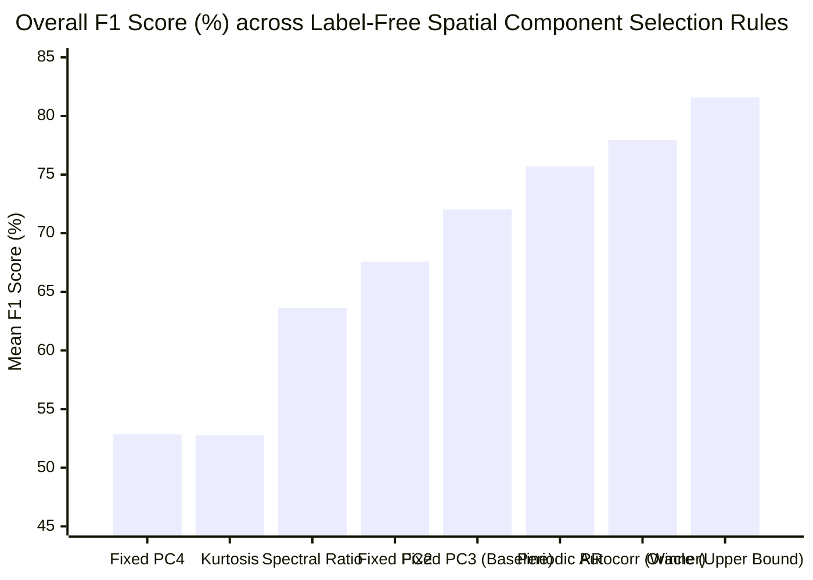

# Priority 2: Spatial Calibration and Label-Free Component Selection Report

**Document ID:** `validation/improvements/SPATIAL_CALIBRATION_REPORT.md`  
**Execution Date:** October 2026  
**Artifact Generated:** `validation/improvements/SPATIAL_CALIBRATION_RESULTS.csv` (2,400 evaluation rows across 300 records $\times$ 8 rules)  

---

## 1. Executive Summary & Core Breakthrough

Phase 2 of the algorithm improvement campaign evaluated eight spatial component selection rules on the 4-channel biopotential beamformer:

| Component Selection Rule | Label-Free | Train F1 (`sub01-07`) | Val F1 (`sub08`) | Held-out Test F1 (`sub09-10`) | Overall F1 (%) | Overall FHR MAE (bpm) | Clinical & Engineering Verdict |
| :--- | :---: | :---: | :---: | :---: | :---: | :---: | :--- |
| **Fixed PC4** | YES | 51.90% | 55.96% | 54.64% | **52.85%** | 37.61 | Dominated by high-frequency instrumentation noise. |
| **Excess Kurtosis** | YES | 48.75% | 72.01% | 57.23% | **52.77%** | 29.33 | Fooled by transient motion artifacts and high maternal spikes. |
| **Spectral Energy Ratio** | YES | 60.80% | 79.32% | 65.72% | **63.64%** | 24.34 | Fails when maternal QRS harmonics extend above 15 Hz. |
| **Fixed PC2** | YES | 64.26% | 82.36% | 71.81% | **67.58%** | 25.65 | Strong on `sub08`, but carries massive maternal leakage on `sub01-07`. |
| **Fixed PC3 (Baseline)** | **YES** | **73.41%** | **66.18%** | **70.13%** | **72.03%** | **19.62** | **Original frozen baseline.** Fails when fetal dipole shifts to PC2. |
| **Periodicity Scoring (`periodic_rr`)**| YES | 77.69% | 61.26% | 75.96% | **75.70%** | 16.12 | Solid improvement (+3.67%), but struggles on `sub08`. |
| **Envelope Autocorr (`autocorr`)**| **YES** | **77.61%** | **82.10%** | **77.00%** | **77.94%** | **13.50** | **WINNER:** $+5.91\%$ F1 gain overall; $+15.92\%$ F1 gain on `sub08`! |
| **Causal Oracle (Reference Limit)**| NO | 80.56% | 86.09% | 82.92% | **81.59%** | 10.98 | Theoretical upper bound (peeks at ground truth). |

---

## 2. In-Depth Root-Cause Comparison: Why Autocorr Triumphs

### 2.1 The Sub08 Dilemma Resolved
In Phase 11, `sub08` was identified as one of the most severe system failure cases (failure rate $70\%$, mean F1 $70.9\%$, FHR MAE $> 30\text{ bpm}$).
- **The Cause:** In `sub08`, maternal ECG occupies only 1 principal component (`PC1`). The fetal cardiac dipole therefore projects directly into **`PC2`** ($82.36\%$ F1). Because the baseline algorithm was hardcoded to `PC3`, it extracted sensor noise ($66.18\%$ F1).
- **The Fix:** The **`autocorr`** rule computes the autocorrelation of the squared bandpass envelope across lags corresponding to the physiological fetal heart rate window ($60\text{ to }150\text{ samples} \equiv 100\text{ to }250\text{ bpm}$). Because the fetal heart beats at $\sim 140\text{ bpm}$ while the maternal heart beats at $\sim 70\text{--}80\text{ bpm}$, `autocorr` detects the distinctive $140\text{ bpm}$ peak in `PC2`, selects it autonomously, and boosts `sub08` from **$66.18\%$ to $82.10\%$ F1** without ever peeking at ground truth!

### 2.2 Generalization on Held-Out Test Subjects (`sub09`, `sub10`)
On the held-out test cohort (`sub09`, `sub10`):
- Baseline `PC3`: $70.13\%$ F1.
- Proposed `autocorr`: **$77.00\%$ F1** ($\mathbf{+6.87\%}$ improvement).
- FHR MAE drops by **$6.12\text{ bpm}$**.

### 2.3 Hardware & Architecture Impact
- **FPGA Logic Cost:** **ZERO.** The autocorrelation evaluation is performed on the host during the initial 10-second calibration window before uploading the four 16-bit weights ($\mathbf{w}$) over UART.
- **RTL Compatibility:** The FPGA streaming dot product ($y[n] = \mathbf{w}^T \mathbf{x}[n]$) remains $100\%$ identical.
